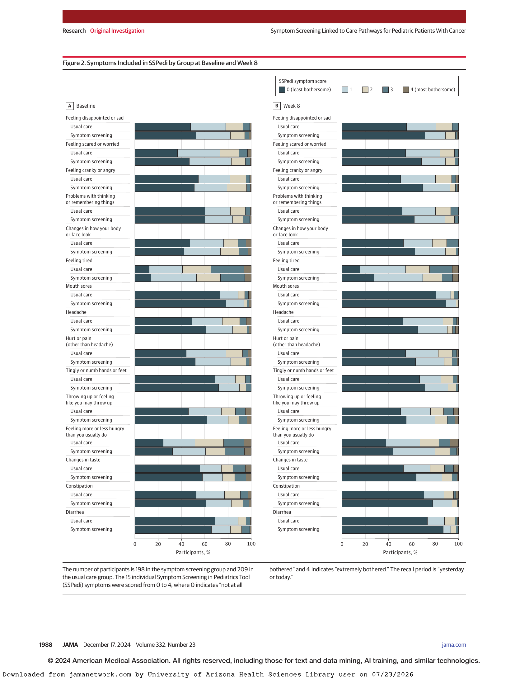

# Main-paper quantitative evidence map

Scope: DOC-001, REPORT, all 11 physical PDF pages (printed 1981–1991). Runtime agent: 01a129b1-193e-71e0-bfc4-ffd8db937dad. Role: qc162_main_quantitative_mapper, gpt-6.1-sol/medium. This is a new descriptive reconstruction, without candidate diagnoses or legacy conclusions.

Source links below are relative to this artifact. Main source: [DOC-001](../../../jama_dupuis_2024_oi_240111_1733431204.38761.pdf#page=1). Reusable locators: .ai_paper_validation/document_outputs/DOC-001/native_text/page-001.txt through page-011.txt; visual aids images/page-005.png through page-009.png. Reuse engine: Poppler native/layout PDF text and CPU-rendered source pages as recorded in evidence_asset_inventory.md. All five retained images were visually inspected. No new rendering, OCR, Python extraction, external source, or alteration of reused assets was performed. All units are reusable-backed; fresh-required units: 0. Scientific coverage gaps: none. A graphical display without printed segment values cannot supply exact numerical segment percentages; its axes, categories, populations, directions, and all 60 stacked bars are mapped below and the complete figure is retained as linked evidence.

## Complete page coverage

| Physical page | Printed page | Content mapped | Coverage |
|---|---|---|---|
| 1 | 1981 | Abstract: design, population, intervention, primary and secondary definitions, age/sex, means, effects, conclusions | COMPLETE |
| 2 | 1982 | Key Points, eligibility, randomization/strata/block size, pathway-adaptation percentages, timing | COMPLETE |
| 3 | 1983 | Intervention, collection windows, scales/direction, endpoints, sample-size inputs, primary model | COMPLETE |
| 4 | 1984 | All secondary/sensitivity/missing-data/test methods, recruitment, populations, ICC, repeated outcomes and narrative effects | COMPLETE |
| 5 | 1985 | Every Figure 1 node/reason/count and footnote, documentation/intervention narrative | COMPLETE; visually inspected |
| 6 | 1986 | All Table 1 rows/denominators/footnotes, continuation of intervention narrative, encounters, discussion claims | COMPLETE; visually inspected |
| 7 | 1987 | Every Table 2 row, four descriptive cells, two effects/CIs, adjusted P, populations and all footnotes | COMPLETE; visually inspected |
| 8 | 1988 | Figure 2: all 15 symptoms × 2 groups × 2 times, score-category colors/segments, percent axes, sample sizes and recall | COMPLETE; visually inspected |
| 9 | 1989 | Every Table 3 distribution row, means/SDs/rates, both effects/intervals/P values and separate model footnotes; discussion | COMPLETE; visually inspected |
| 10 | 1990 | Baseline and reduction claims, 3-day abstraction window, conclusions; author/funding metadata has no applicable quantitative trial result | COMPLETE |
| 11 | 1991 | All references inspected; citation/year/page/DOI numerals contain no applicable trial-result relationship | COMPLETE; no applicable additional relationship |

## Reading conventions and identifiers

I = symptom screening/intervention; U = usual care/control. Pairs always I ; U unless explicitly marked. Counts with parentheses are count (percentage); continuous values are mean (SD), or median (range/IQR) as labeled. All confidence intervals are 95%; CrI explicitly denotes credible interval. A relationship row can contain a complete matched display (multiple group/time cells) rather than one scalar. N001–N096: 96 numeric/reporting relationships. S001–S040: 40 inferential/design/method relationships. S rows link descriptive N rows rather than duplicating their identities. The exact transcription appendix preserves complete page text, including all contextual qualifiers and source labels.

## Design, definitions, and narrative numeric relationships

| ID | Source location | Relationship and exact displayed values / matching keys |
|---|---|---|
| N001 | pp. 1–2 abstract/design/Methods; p. 5 Figure 1 | Cluster RCT; 20 US pediatric cancer centers/sites; 10 I and 10 U; enrollment 221 I, 224 U, total 445. Patient age eligibility 8–18 y; newly diagnosed receiving/planned chemotherapy, radiotherapy or operation; English/Spanish. |
| N002 | p. 2 Participants/Randomization | Enrollment within 28 days after treatment initiation or cancer diagnosis, whichever later. Exclude recurrent/second malignancy, cognitive disability below second-grade equivalent, inability to see SPARK. Two site stratification factors split at medians: eligible English/Spanish-speaking patient number; historical privately insured percentage. Block size 2 (1 I, 1 U); ready sets of 2 or 4 sites within a stratum. Site randomization March 26, 2021–February 17, 2022. |
| N003 | p. 1 abstract; p. 4 Results | Enrollment July 2021–August 2023; body July 27, 2021–August 22, 2023. Final follow-up October 18, 2023. |
| N004 | pp. 1–3 intervention | Thrice-weekly/3-times-weekly SSPedi prompts through SPARK; health-team emailed report when ≥1 symptom score 3 or 4 on 0–4 scale. Pathways in place before enrollment and throughout study. |
| N005 | p. 2 pathway adaptation | Across intervention sites: 40.8% statements adopted; 48.7% adapted; 6.4% rejected. Rejected per site range 3.7%–18.5%. Matching supplement eTables 2–3. |
| N006 | pp. 1–3 outcomes; p. 7 Table 2 footnote a; p. 8 caption | Total SSPedi sum of 15 individual items, each 0–4; total 0–60; higher = more bothersome; 0 not at all bothered; 4 extremely bothered; recall yesterday or today. Primary self-reported total at week 8; collection baseline, week 4 ±1 week, week 8 ±1 week; 4/8-week outcome assessments distinct from intervention administration. |
| N007 | pp. 1,3; p. 7 Table 2 | PROMIS Ped Bank v2.0–Fatigue; normative mean (SD) 50 (10); higher = more fatigue; recall past 7 days. PedsQL 3.0 Acute Cancer Module, 8 domain scores, range 0–100; higher = better health; recall 7 days. All measures English/Spanish validated for cancer patients 8–18 y. |
| N008 | pp. 3–4 methods; p. 10 limitations | Documentation, any intervention, symptom-specific intervention: binary yes/no for each 15 SSPedi symptoms; 3-day abstraction window from 1 day before to 1 day after week 4/8 assessment. Any intervention independent of indication; symptom-specific clearly documented for symptom. Analyses all participants, symptom score ≥1, symptom score ≥3; symptom-specific denominators. Two independent abstractors with consensus/arbitration. |
| N009 | p. 3 sample size | Planned n=444; power 85%; minimal clinically important difference 3; within-cluster SD 8.8; ICC .021; alpha .05; baseline covariate explains 20% variance; missing data 10%. |
| N010 | p. 4 Results; p. 5 Figure 1 | Assessed 687; approached 530; enrolled 445 (221/224); medical-record-review-only enrollment 15 (4/11). Declined participation 16.6% I vs 15.5% U; P=.81. |
| N011 | p. 4 Results | Missing week-8 SSPedi 38/445 (8.5%) overall; 23/430 (5.3%) excluding initial record-only enrollment. Observed posterior ICC median .06, 95% CrI .01–.16; site-size coefficient of variation .61. |
| N012 | pp. 1,4 Results; p. 6 Table 1 | Overall age median (range) 14.8 (8.1–18.9) y; male 262 (58.9%). |
| N013 | p. 4 Results; pp. 5,7 displays | SSPedi contributors I: baseline 216, week 4 208, week 8 198; U: 213,207,209. Only 1 participant did not complete planned observations (context points to withdrawal/record review detail). Other week-8 PRO n=202 I/209 U; medical-record n=220/224. |
| N014 | pp. 1,2,4,7 and p. 10 | Primary week-8 SSPedi mean (SD) I 7.9 (7.2), U 11.4 (8.7); adjusted mean difference I−U −3.8 (−6.4 to −1.2), P=.007 in body/Table 2. Key Points 7.9 vs 11.4, adjusted −3.8; p.10 reduction magnitude 3.8. Abstract/body claim improved symptom scores. Table 2/eTable 6/eFigure 1 are matching keys. |
| N015 | p. 4 Results | Ad hoc adjusted baseline SSPedi difference −1.8 (−3.5 to −0.1), P=.04; eTable 7. Change from baseline comparison with baseline in fully adjusted model: difference −3.0 (−5.2 to −0.8); eFigure 1. |
| N016 | pp. 1,4,6,9–10 narrative | All 15 individual symptom odds higher scores reduced; statistically significant for 12/15. Fatigue no significant difference; all adjusted PedsQL differences >0, none significant. Encounters: ED significantly greater I; unplanned clinic/hospitalization no significant differences. Symptom-specific intervention increased; baseline SSPedi significantly better I. |

## Figure 1 flow: every node and partition

Exact source: [p. 5 Figure 1](../../../jama_dupuis_2024_oi_240111_1733431204.38761.pdf#page=5). Subreasons remain within their parent; do not add parent and subreasons as separate exclusions.

| ID | Node / reason | I | U |
|---|---|---:|---:|
| N017 | Sites invited / randomized / assigned | 20 overall; randomized 20 overall; assigned 10 | assigned 10 |
| N018 | Considered / missed window / screened | 472 / 108 / 364 | 387 / 64 / 323 |
| N019 | Excluded overall | 99 | 58 |
| N020 | Physician preference; nested not oncology care/unable to approach, disease status/progression, psychosocial, reason absent | 42; nested 32,4,2,4 | 13; nested oncology-care category not displayed,7,4,2 |
| N021 | Treatment outside trial network; cognitive disability; not English/Spanish; visual impairment; no parent; cancer not disclosed | 26;16;8;3;3;1 | 15;14;7;4;3;2 |
| N022 | Invited / declined / enrolled | 265 / 44 / 221 | 265 / 41 / 224 |
| N023 | Decline reasons: uninterested; stressed/overwhelmed; no reason; busy | 29;12;2;1 | 20;19; not displayed;2 |
| N024 | Agreed PRO / completed all week-8 surveys incl SSPedi / not complete | 217 / 198 / 19 | 213 / 209 / 4 |
| N025 | Noncompletion reasons: missed window; omitted SSPedi; sick/overwhelmed; declined; switched record-only; moved off study | 7;4;3;2;2;1 | 2; not displayed; not displayed;1;1; not displayed |
| N026 | Enrolled record-only / final primary / secondary PRO / secondary record analysis | 4 / 198 / 202 / 220 | 11 / 209 / 209 / 224 |

Footnote a: stratified by anticipated eligible English/Spanish number and historical privately insured percentage. Footnote b: participants declining PRO were asked permission for record review only; covers initial enrollment and switches.

## Table 1: every baseline row

Exact source: [p. 6 Table 1](../../../jama_dupuis_2024_oi_240111_1733431204.38761.pdf#page=6). Default denominators 221 I/224 U; race 177/183; ethnicity 208/202. No inferential P values in this table. Treatments are separate planned/received indicators, not mutually exclusive categories.

| ID | Characteristic / unit | I | U | Denominator / statistic |
|---|---|---|---|---|
| N027 | Male | 133 (60.2) | 129 (57.6) | 221/224 |
| N028 | Female | 88 (39.8) | 95 (42.4) | 221/224 |
| N029 | Age, years | 15.0 (8.1–18.9) | 14.7 (8.1–18.9) | median (range) |
| N030 | Age 8–10 /11–14 /15–18 y | 33 (14.9);77 (34.8);111 (50.2) | 37 (16.5);85 (37.9);102 (45.5) | 221/224 |
| N031 | American Indian/Alaska Native | 2 (1.1) | 4 (2.2) | 177/183 |
| N032 | Asian | 13 (7.3) | 7 (3.8) | 177/183 |
| N033 | Black/African American | 13 (7.3) | 14 (7.7) | 177/183 |
| N034 | Native Hawaiian/Other Pacific Islander | 14 (7.9) | 1 (0.5) | 177/183 |
| N035 | White | 113 (63.8) | 145 (79.2) | 177/183 |
| N036 | More than 1 race | 22 (12.4) | 12 (6.6) | 177/183 |
| N037 | Hispanic/Latino | 85 (40.9) | 63 (31.2) | 208/202 |
| N038 | Not Hispanic/Latino | 123 (59.1) | 139 (68.8) | 208/202 |
| N039 | First language English/Spanish | 211 (95.5) | 197 (87.9) | 221/224 |
| N040 | Inpatient at enrollment | 88 (39.8) | 88 (39.3) | 221/224 |
| N041 | Preferred PRO language English / Spanish / not applicable or unavailable | 203 (91.9);13 (5.9);5 (2.3) | 201 (89.7);12 (5.4);11 (4.9) | 221/224 |
| N042 | Guardian married | 138 (62.4) | 141 (62.9) | 221/224 |
| N043 | Guardian employed full/part time | 125 (56.6) | 127 (56.7) | 221/224 |
| N044 | Guardian college graduate or higher | 120 (54.3) | 133 (59.4) | 221/224 |
| N045 | Annual household income ≥$60,000 | 78 (35.3) | 103 (46.0) | 221/224 |
| N046 | Leukemia / solid tumor / lymphoma / brain tumor | 89 (40.3);73 (33.0);50 (22.6);9 (4.1) | 62 (27.7);86 (38.4);61 (27.2);15 (6.7) | 221/224 |
| N047 | Metastatic disease | 45 (20.4) | 80 (35.7) | 221/224 |
| N048 | Diagnosis-to-enrollment, days | 23 (16–29) | 21 (13–28) | median (IQR) |
| N049 | Chemotherapy / radiotherapy / surgical procedure | 210 (95.0);20 (9.0);23 (10.4) | 207 (92.4);18 (8.0);36 (16.1) | 221/224 |

Footnote a: parent-reported race/ethnicity using limited categories; more than 1 race selectable. Footnote b: language not applicable for initial record-only participants; unavailable for 1 participant withdrawing immediately after enrollment.

## Table 2 complete cells and statistical relationships

Exact source: [p. 7 Table 2](../../../jama_dupuis_2024_oi_240111_1733431204.38761.pdf#page=7). Four descriptive columns: baseline I (216), baseline U (213), week-8 I (198), week-8 U (209). Other PROs have week-8 I 202 instead. Continuous cells mean (SD); symptom cells number (%) with score 3–4. The individual-symptom inferential effects are ordinal proportional-odds ORs for higher scores across 0–4, rather than binary severe-symptom ORs. Unadjusted and adjusted effects are retained separately. Contrasts I versus U; continuous difference I−U. All intervals 95% CI. Footnote b: unadjusted models include stratification variables; adjusted continuous mixed linear models have site random effect, treatment/age/diagnosis fixed effects, and 2 cluster strata effects; adjusted ordinal mixed proportional-odds models have site random effect, treatment and 2 strata fixed effects. Footnote c: P based on mean week-8 score, not change in mean score. Scale/recall footnote a is mapped at N006/N007.

| Numeric ID | Statistical ID | Outcome | Baseline I | Baseline U | Week 8 I | Week 8 U | Unadjusted effect (CI) | Adjusted effect (CI) | Adjusted P |
|---|---|---|---|---|---|---|---|---|---|
| N050 | S001 | Total SSPedi | 11.8 (8.2) | 13.5 (8.2) | 7.9 (7.2) | 11.4 (8.7) | −3.7 (−6.3 to −1.1) | −3.8 (−6.4 to −1.2) | .007 |
| N051 | S002 | Sad/disappointed | 12 (5.6) | 15 (7.0) | 5 (2.5) | 11 (5.3) | .46 (.24–.89) | .46 (.26–.83) | .01 |
| N052 | S003 | Scared/worried | 11 (5.1) | 23 (10.8) | 6 (3.0) | 7 (3.3) | .58 (.38–.88) | .57 (.38–.85) | .005 |
| N053 | S004 | Cranky/angry | 9 (4.2) | 10 (4.7) | 5 (2.5) | 12 (5.7) | .43 (.29–.63) | .43 (.29–.63) | <.001 |
| N054 | S005 | Thinking/remembering | 15 (6.9) | 11 (5.2) | 7 (3.5) | 14 (6.7) | .60 (.38–.95) | .62 (.42–.90) | .01 |
| N055 | S006 | Body/face appearance changes | 23 (10.6) | 24 (11.3) | 4 (2.0) | 21 (10.0) | .51 (.30–.89) | .52 (.31–.88) | .01 |
| N056 | S007 | Tired | 57 (26.4) | 74 (34.7) | 28 (14.1) | 52 (24.9) | .52 (.36–.74) | .52 (.36–.74) | <.001 |
| N057 | S008 | Mouth sores | 8 (3.7) | 12 (5.6) | 0 (0.0) | 8 (3.8) | .49 (.28–.86) | .48 (.27–.85) | .01 |
| N058 | S009 | Headache | 8 (3.7) | 21 (9.9) | 10 (5.1) | 10 (4.8) | .60 (.41–.89) | .61 (.41–.90) | .01 |
| N059 | S010 | Hurt/pain other than headache | 10 (4.6) | 16 (7.5) | 11 (5.6) | 11 (5.3) | .70 (.48–1.03) | .69 (.47–1.01) | .06 |
| N060 | S011 | Tingly/numb hands/feet | 10 (4.6) | 11 (5.2) | 4 (2.0) | 10 (4.8) | .76 (.50–1.15) | .76 (.50–1.15) | .19 |
| N061 | S012 | Throwing up/nausea | 23 (10.6) | 29 (13.6) | 19 (9.6) | 27 (12.9) | .81 (.50–1.34) | .80 (.51–1.26) | .34 |
| N062 | S013 | More/less hungry | 49 (22.7) | 51 (23.9) | 15 (7.6) | 35 (16.7) | .63 (.43–.94) | .63 (.44–.90) | .01 |
| N063 | S014 | Taste changes | 31 (14.4) | 34 (16.0) | 11 (5.6) | 25 (12.0) | .56 (.33–.93) | .56 (.34–.90) | .02 |
| N064 | S015 | Constipation | 16 (7.4) | 20 (9.4) | 2 (1.0) | 9 (4.3) | .53 (.27–1.06) | .55 (.31–.95) | .03 |
| N065 | S016 | Diarrhea | 18 (8.3) | 10 (4.7) | 4 (2.0) | 6 (2.9) | .38 (.19–.75) | .37 (.19–.73) | .004 |
| N066 | S017 | PROMIS Fatigue | 53.9 (12.1) | 54.6 (12.1) | 49.3 (13.3) | 49.8 (12.9) | −.5 (−3.5 to 2.4) | −.7 (−4.0 to 2.5) | .64 |
| N067 | S018 | PedsQL pain/hurt | 69.8 (26.6) | 68.8 (24.8) | 76.2 (26.5) | 76.1 (24.2) | −.1 (−6.1 to 6.0) | .2 (−5.9 to 6.2) | .95 |
| N068 | S019 | PedsQL nausea | 73.9 (23.4) | 69.2 (20.7) | 71.1 (23.1) | 70.4 (23.3) | .9 (−5.7 to 7.6) | 1.3 (−4.9 to 7.6) | .66 |
| N069 | S020 | PedsQL procedural anxiety | 66.4 (30.3) | 62.8 (29.1) | 75.8 (27.9) | 71.1 (26.1) | 3.5 (−4.5 to 11.4) | 3.0 (−4.5 to 10.5) | .41 |
| N070 | S021 | PedsQL treatment anxiety | 77.7 (26.3) | 76.0 (23.4) | 83.9 (22.2) | 80.4 (23.0) | 2.9 (−3.4 to 9.3) | 2.9 (−3.4 to 9.1) | .34 |
| N071 | S022 | PedsQL worry | 64.7 (26.6) | 62.8 (22.8) | 72.9 (24.4) | 69.5 (24.4) | 3.1 (−2.8 to 9.1) | 3.6 (−2.4 to 9.6) | .22 |
| N072 | S023 | PedsQL cognitive problems | 70.3 (21.2) | 69.1 (20.6) | 75.3 (21.5) | 74.5 (21.4) | .9 (−5.4 to 7.2) | 1.2 (−5.5 to 7.9) | .71 |
| N073 | S024 | PedsQL physical appearance | 74.7 (25.0) | 73.2 (26.4) | 77.6 (23.8) | 77.3 (24.6) | .2 (−5.1 to 5.4) | .6 (−5.0 to 6.1) | .83 |
| N074 | S025 | PedsQL communication | 77.8 (21.3) | 73.2 (21.7) | 79.6 (21.2) | 77.8 (21.2) | 1.8 (−2.6 to 6.3) | 1.8 (−3.1 to 6.6) | .45 |

## Figure 2: all graphical relationships

N075: [p. 8 Figure 2](../../../jama_dupuis_2024_oi_240111_1733431204.38761.pdf#page=8). Panel A Baseline; panel B Week 8. Same 15-symptom order as N051–N065. Every symptom has U above I in both panels, hence 60 complete 100%-stacked bars. Five ordered colored categories, left-to-right 0,1,2,3,4. X axes Participants %, ticks 0,20,40,60,80,100. Caption states n=198 I and 209 U without separately assigning baseline n. Scores 0–4, 0 not at all bothered, 4 extremely bothered; yesterday/today recall. Figure provides no printed segment percentages; widths are visual evidence, not exact numerals. At week 8 the rightmost score-3/4 portions map to N051–N065; the whole five-category distributions map to ordinal S002–S016. Baseline displays map to their corresponding baseline count cells, subject to figure-caption population matching. Every bar and segment was inspected. The retained complete graphical data is accessible below; no graphical row is omitted or represented as a printed exact count.



| Symptom matching key | Baseline U/I bars inspected | Week-8 U/I bars inspected | Graphical direction/detail |
|---|---|---|---|
| N051 sad | both five-score distributions | both five-score distributions | I greater score-0 share at both times; week-8 severe share smaller I |
| N052 worried | both five-score distributions | both five-score distributions | I greater score-0 share at both times; week-8 severe tails similarly small |
| N053 angry | both five-score distributions | both five-score distributions | I greater score-0 share; week-8 severe share smaller I |
| N054 thinking | both five-score distributions | both five-score distributions | Baseline score-0 shares close; week-8 score-0 larger I |
| N055 appearance | both five-score distributions | both five-score distributions | Baseline score-0 smaller I; week-8 larger I; severe share smaller I at week 8 |
| N056 tired | both five-score distributions | both five-score distributions | Nonzero scores dominate baseline; week-8 severe share smaller I |
| N057 mouth sores | both five-score distributions | both five-score distributions | Score 0 dominates both; week-8 I no visible score-3/4 segment |
| N058 headache | both five-score distributions | both five-score distributions | Score-0 larger I; small severe tails in both week-8 bars |
| N059 pain | both five-score distributions | both five-score distributions | Score-0 larger I; small similar severe tails at week 8 |
| N060 tingling | both five-score distributions | both five-score distributions | Score-0 dominates; larger I week-8 zero share |
| N061 vomiting | both five-score distributions | both five-score distributions | Score-0 larger I; all levels visibly represented in week-8 bars |
| N062 hunger | both five-score distributions | both five-score distributions | Baseline nonzero scores dominate; week-8 I severe share smaller |
| N063 taste | both five-score distributions | both five-score distributions | Similar baseline zero shares; week-8 I zero share larger/severe smaller |
| N064 constipation | both five-score distributions | both five-score distributions | Score-0 majority; week-8 I severe tail very small |
| N065 diarrhea | both five-score distributions | both five-score distributions | Score-0 majority; small severe tails; week-8 I zero share larger |

## Documentation and intervention narrative

[pp. 4–6 Results](../../../jama_dupuis_2024_oi_240111_1733431204.38761.pdf#page=5). Default medical-record denominators I 220/U224; comparisons at week 8; matching supplement eTables 10–11. Any intervention differs from symptom-specific provision.

| ID | Outcome / population | I | U | Printed test/direction |
|---|---|---|---|---|
| N076 | Fatigue documentation, all | 43/220 (19.5%) | 61/224 (27.2%) | P=.04; more common U |
| N077 | Hunger-change documentation, all | 22/220 (10.0%) | 37/224 (16.5%) | P=.03; more common U |
| N078 | Sadness any intervention, all | 52/220 (23.6%) | 82/224 (36.6%) | P=.05; text says significantly more common U |
| N079 | Anxiety any intervention, all | 54/220 (24.5%) | 96/224 (42.9%) | P=.01; more common U |
| N080 | Pain symptom-specific, all | 40 (18.2%) | 9 (4.0%) | More common I |
| N081 | Peripheral neuropathy symptom-specific, all | 8 (3.6%) | Not printed here | More common I |
| N082 | Hunger symptom-specific, all | 10 (4.5%) | Not printed here | More common I |
| N083 | Constipation symptom-specific, all | 15 (6.8%) | 5 (2.2%) | More common I |
| N084 | Pain symptom-specific, symptom ≥1 | 25/73 (34.2%) | 5/95 (5.3%) | More common I |
| N085 | Peripheral neuropathy symptom-specific, symptom ≥1 | 6/57 (10.5%) | 0/70 | More common I |
| N086 | Hunger symptom-specific, symptom ≥1 | 6/111 (5.4%) | 0/130 | More common I |
| N087 | Sadness symptom-specific, symptom ≥3 | 4/5 (80.0%) | 2/11 (18.2%) | More common I |
| N088 | Nausea/vomiting symptom-specific, symptom ≥3 | 7/19 (36.8%) | 2/27 (7.4%) | More common I |
| N089 | Narrative significance patterns | Pain, neuropathy, hunger: all and score≥1; constipation: all; sadness, pain, nausea/vomiting: score≥3 | Reference U | Statement: significantly more common I; no additional numerical tests printed in main |

## Table 3 complete encounter relationships

Exact source: [p. 9 Table 3](../../../jama_dupuis_2024_oi_240111_1733431204.38761.pdf#page=9). I n=220/U n=224; no participant less than 8 weeks follow-up. Means count encounters per patient over 8 weeks. Rates per 100 patient-weeks. Distribution cells number (%). Absolute difference has 95% CrI, from marginalizing mixed Poisson with treatment and site random effect only; RR has 95% CI, mixed Poisson with treatment, site random effect and both strata; P labeled adjusted. Do not treat the absolute difference as unadjusted subtraction of printed marginal rates. Total combines ED, unplanned clinic and admissions.

| ID | Statistical ID | Outcome | Mean (SD) I ; U | Rate I ; U | Absolute rate difference (95% CrI) | RR (95% CI) | P |
|---|---|---|---|---|---|---|---|
| N090 | S026 | Total | 1.82 (2.34) ; 1.12 (1.62) | 22.8 ; 14.0 | 6.13 (−1.56 to 14.51) | 1.46 (.97–2.19) | .07 |
| N091 | S027 | ED | .77 (1.12) ; .45 (.81) | 9.6 ; 5.6 | 3.38 (−.57 to 7.94) | 1.72 (1.03–2.87) | .04 |
| N092 | S028 | Unplanned clinic | .40 (1.09) ; .24 (.58) | 5.1 ; 3.0 | −.01 (−3.23 to 3.04) | 1.01 (.41–2.50) | .99 |
| N093 | S029 | Unplanned hospital | .65 (.93) ; .43 (.81) | 8.1 ; 5.4 | 2.28 (−.59 to 5.16) | 1.40 (.96–2.03) | .08 |
| N094 | — | Total distribution: encounters 0,1,2,3,4,5,≥6 | I 95(43.2),22(10.0),42(19.1),22(10.0),17(7.7),5(2.3),17(7.7) | U 117(52.2),40(17.9),34(15.2),11(4.9),11(4.9),6(2.7),5(2.2) | — | — | — |
| N095 | — | ED distribution: 0,1,2,3,4,5,≥6 | I 126(57.3),49(22.3),25(11.4),12(5.5),7(3.2),0,1(.5) | U 155(69.2),48(21.4),14(6.2),5(2.2),1(.4),1(.4),0 | — | — | — |
| N096 | — | Clinic distribution 0,1,2,≥3; hospital distribution 0,1,2,3,4 | Clinic I 174(79.1),27(12.3),11(5.0),8(3.6); hospital I 130(59.1),51(23.2),28(12.7),8(3.6),3(1.4) | Clinic U 182(81.2),34(15.2),5(2.2),3(1.3); hospital U 161(71.9),40(17.9),13(5.8),9(4.0),1(.4) | — | — | — |

N091 matches abstract/body pp.1,6: .77(1.12) vs .45(.81), RR1.72(1.03–2.87), significantly more ED I. Absolute differences do not appear in abstract. Figure/table captions and source printed CrI labels are retained exactly.

## Additional inferential, method, and design relationships

S001–S029 above include every table estimate, both interval columns, and its stated P. Their matched scale/direction/population/model labels are part of each relationship. Remaining relationships are:

| ID | Source location | Complete method/result relationship |
|---|---|---|
| S030 | p.3 sample size; N009 | n444, 85% power, MCID3, within-cluster SD8.8, ICC.021, alpha.05, baseline variance20%, missing10%; declared inputs for planned primary design. |
| S031 | pp.3–4 primary analysis; p.7 footnotes | Patient-level week-8 total SSPedi outcome; mixed linear regression site random effect; treatment, age groups 8–10/11–14/15–18, diagnosis leukemia/lymphoma/solid/brain, and 2 binary cluster strata fixed effects. Covariate-adjusted mean difference/95%CI; test of week-8 means rather than mean change. Baseline not planned adjusted because pre-enrollment pathways could affect it. |
| S032 | p.4 sensitivity/ad hoc; N015 | Sensitivity adjusts baseline SSPedi; fully adjusted change baseline→week8 including baseline; sensitivity restricts systemic chemotherapy; ad hoc fully adjusted baseline comparison. Baseline adjusted −1.8(−3.5,−.1), P.04; baseline-adjusted change −3.0(−5.2,−.8). Text reports sensitivity findings maintained. |
| S033 | p.4 ordinal analysis; S002–S016 | Each of 15 week-8 individual symptom scores ordinal0–4; mixed proportional odds with site random effect, treatment and 2 strata fixed effects; OR95%CI. Table 2 descriptive severe counts score3–4 do not define the ordinal inferential endpoint. |
| S034 | p.4 other PRO analysis; S017–S025 | Week-8 PROMIS and 8 PedsQL domains same analysis approach as primary. Higher fatigue worse, higher PedsQL better; all PedsQL adjusted differences >0; no significant fatigue/QOL effect claimed. |
| S035 | pp.3–4 binary outcome analysis; N076–N089 | Mixed or fixed logistic regression (details in supplementary eText), OR95%CI. Separate comparisons all participants, symptom≥1, symptom≥3; denominators vary by symptom; any intervention vs clearly symptom-specific. Printed narrative P values: fatigue documentation .04, hunger .03, sadness any intervention .05, anxiety .01. |
| S036 | pp.4,9 encounters; S026–S029 | Number events/patient over8 weeks; mixed Poisson site random effect, treatment per Table3 and 2 strata; analogous negative-binomial robustness (supplement eText). Absolute rate difference per100patient-weeks marginalized from treatment+site-only mixed Poisson,95%CrI; RR from strata-adjusted model,95%CI. |
| S037 | p.4 analysis rules | No planned interim or subgroup analyses. Multiple imputation planned if >10% data missing. SAP uploaded before analysis. R4.3.2. All significance tests 2-sided; P<.05 significant. Missing fractions N011; supplement eFigure1 sensitivity/missing-data approach. |
| S038 | p.4 Results; N010–N011 | Decline I16.6%/U15.5%, P.81; posterior ICC median.06 CrI.01–.16, site-size CV.61. |
| S039 | pp.1,2,4,6–10; N014,N016,N089,N091 | Matching interpretation statements: improved week8 total; lower odds for all15,12 significant; no fatigue/QOL difference; more symptom-specific interventions; more ED despite hypothesis of fewer unplanned encounters; baseline significantly better I; p10 reduction3.8 and need to understand clinical relevance. |
| S040 | pp.2–3 randomization and outcomes; N001–N008 | Randomization unit site, analysis unit patient; strata split medians, block2; intervention thrice-weekly and initiated before enrollment; all baseline/week4/week8±1week assessments; primary8-week SSPedi, secondary15individual symptoms/fatigue/8QOL domains/documentation/interventions/unplanned encounters. Planned/reported matching keys for protocol/SAP support comparison. |

## Complete exact page-text transcription aid

The following complete reusable per-page native/layout text is appended as a locator aid. This preserves all wording, values, labels, footnotes, matching statements, and metadata. It adds no relationship IDs or conclusions; figures/tables are mapped above and final source authority remains the PDF page. No old scientific artifact is included.

### DOC-001 physical page 001

```text
                 Research


              JAMA | Original Investigation

              Symptom Screening Linked to Care Pathways for Pediatric Patients
              With Cancer
              A Randomized Clinical Trial
              L. Lee Dupuis, RPh, PhD; Emily Vettese, BASc; Allison C. Grimes, MD, MSCI; Melissa P. Beauchemin, PhD;
              Lisa M. Klesges, PhD; Christina Baggott, PhD; Jenna Demedis, MD, MS; Catherine Aftandilian, MD;
              David R. Freyer, DO, MS; Nicole Crellin-Parsons, BSc; Etan Orgel, MD, MS; David Dickens, MD;
              Kara M. Kelly, MD; Wade Kyono, MD; Alexandra Walsh, MD; Farha Sherani, MD; Daniel Cannone, DO;
              Andrea D. Orsey, MD, MSCE, MS-HPEd; Allison A. King, MD, PhD; Lolie Yu, MD, MPH;
              Wendy Woods-Swafford, MD, MPH; Scott M. Bradfield, MD; Michael E. Roth, MD;
              Adam J. Esbenshade, MD, MSCI; Emi H. Caywood, MD; Vibhuti Agarwal, MD;
              Ramamoorthy Nagasubramanian, MD; George A. Tomlinson, PhD; Lillian Sung, MD, PhD


                                                                                                                            Visual Abstract
                  IMPORTANCE Pediatric patients with cancer commonly experience severely bothersome                         Editorial page 1979
                  symptoms. The effectiveness of routine symptom screening with symptom feedback and
                  symptom management care pathways is unknown.                                                              Supplemental content

                                                                                                                            Related article at
                  OBJECTIVE To determine whether thrice-weekly symptom screening with symptom feedback
                                                                                                                            jamapediatrics.com
                  and management care pathways, compared with usual care, improves overall self-reported
                  symptom scores measured by the Symptom Screening in Pediatrics Tool (SSPedi) in pediatric
                  patients with cancer.

                  DESIGN, SETTING, AND PARTICIPANTS This cluster randomized trial enrolled participants
                  between July 2021 and August 2023 from 20 pediatric cancer centers in the US. Patients
                  newly diagnosed with cancer aged 8 to 18 years receiving any cancer treatment were
                  included. Twenty sites were randomized to provide symptom screening (n = 10) vs usual care
                  (n = 10); 221 participants were enrolled at intervention sites and 224 participants at control
                  sites. The date of final follow-up was October 18, 2023.

                  INTERVENTION Symptom screening included providing thrice-weekly symptom screening
                  prompts to participants, email alerts to the health care team, and locally adapted symptom
                  management care pathway implementation.

                 MAIN OUTCOMES AND MEASURES The primary outcome was self-reported total SSPedi score
                 at week 8 (range, 0-60; higher scores indicate more bothersome). Secondary outcomes were
                 Patient-Reported Outcomes Measurement Information System Fatigue score (mean [SD]
                 score, 50 [10]; higher scores indicate more fatigue), Pediatric Quality of Life 3.0 Acute Cancer
                 Module scores (range, 0-100; higher scores indicate better health), symptom documentation
                 and interventions at week 8, and unplanned health care encounters.

                  RESULTS A total of 445 participants (median [range] age, 14.8 [8.1-18.9] years; 58.9% males)
                  were enrolled. The mean (SD) 8-week SSPedi score was 7.9 (7.2) in the symptom screening
                  group vs 11.4 (8.7) in the usual care group. Symptom screening was associated with
                  significantly better 8-week total SSPedi scores (adjusted mean difference, −3.8 [95% CI, −6.4
                  to −1.2]) and less bothersome individual symptoms, with 12 of 15 symptoms being statistically
                  significantly reduced. There was no difference in fatigue or quality of life. The mean (SD)
                  number of emergency department visits was 0.77 (1.12) in the symptom screening group and
                  0.45 (0.81) in the usual care group. There were significantly more emergency department
                  visits in the symptom screening group (rate ratio, 1.72 [95% CI, 1.03-2.87]).

                  CONCLUSIONS Symptom screening with symptom feedback and symptom management care
                  pathways was associated with improved symptom scores and increased symptom-specific                  Author Affiliations: Author
                                                                                                                       affiliations are listed at the end of this
                  interventions. Future work should integrate symptom screening into routine clinical care.            article.
                  TRIAL REGISTRATION ClinicalTrials.gov Identifier: NCT04614662                                        Corresponding Author: Lillian
                                                                                                                       Sung, MD, PhD, Division of
                                                                                                                       Haematology/Oncology, The Hospital
                                                                                                                       for Sick Children, 555 University Ave,
                  JAMA. 2024;332(23):1981-1991. doi:10.1001/jama.2024.19585                                            Toronto, ON, M5G1X8, Canada
                  Published online November 13, 2024.                                                                  (lillian.sung@sickkids.ca).


                                                                                                                                                      (Reprinted) 1981
          © 2024 American Medical Association. All rights reserved, including those for text and data mining, AI training, and similar technologies.
Downloaded from jamanetwork.com by University of Arizona Health Sciences Library user on 07/23/2026

```

### DOC-001 physical page 002

```text
               Research Original Investigation                                    Symptom Screening Linked to Care Pathways for Pediatric Patients With Cancer


               P
                       ediatric patients with cancer experience severely both-
                       ersome symptoms.1-8 Two approaches that may im-               Key Points
                       prove symptom control are routine symptom screening9
                                                                                     Question Does thrice-weekly symptom screening with symptom
               and clinical practice guideline–consistent care. To enable symp-      feedback and symptom management care pathways reduce total
               tom screening, the Symptom Screening in Pediatrics Tool               symptom burden as measured by the Symptom Screening in
               (SSPedi)10 and Supportive care Prioritization, Assessment and         Pediatrics Tool (SSPedi), compared with usual care, among
               Recommendations for Kids (SPARK) were developed.11 SSPedi             pediatric patients newly diagnosed with cancer?
               is a validated self-report symptom assessment tool for pa-            Findings The total 8-week SSPedi score (range, 0-60) was
               tients aged 8 to 18 years receiving cancer treatments. SPARK          significantly better with symptom screening compared with usual
               is a web application that enables access to SSPedi, generates         care (7.9 vs 11.4, respectively; adjusted mean difference, −3.8).
               symptom reports, and distributes reports to the health care
                                                                                     Meaning Among pediatric patients newly diagnosed with cancer,
               team. To increase guideline-consistent care, a process was de-        symptom screening with symptom feedback and symptom
               veloped to create and locally adapt symptom management care           management care pathways was associated with improved total
               pathways.12,13                                                        SSPedi scores compared with usual care.
                    In this cluster randomized clinical trial (RCT), the pri-
               mary objective was to determine whether thrice-weekly symp-
               tom screening with symptom feedback and symptom man-
               agement care pathways, compared with usual care, improves          fied on 2 site characteristics split at their medians: anticipated
               overall self-reported symptom scores in pediatric patients with    number of eligible patients who speak English or Spanish and
               cancer at 8 weeks.                                                 historical percentage of patients with private insurance. Ran-
                                                                                  domization sequence was computer-generated (block size of 2:
                                                                                  1 intervention and 1 control) and concealed from all partici-
                                                                                  pants and the health care and research teams. Once 2 or 4 sites
               Methods                                                            within a stratum were ready for randomization, they were ran-
               This cluster RCT included patients from 20 pediatric oncol-        domized in the order they became ready. Randomization of sites
               ogy sites in the US (eTable 1 in Supplement 2). Sites were ran-    occurred from March 26, 2021, to February 17, 2022.
               domized to either intervention (symptom screening) or con-
               trol groups. The intervention included participant prompts to      Site Preparation and Patient Enrollment
               complete symptom screening 3 times weekly via SPARK,               Before patient enrollment could be activated at the recently
               provision of symptom reports to the health care team, and          randomized intervention and control sites within each stra-
               implementation of locally adapted care pathways for symp-          tum, intervention sites had to accomplish 2 tasks: email con-
               tom management. The control group received usual care.             figuration and care pathway adaptation. First, email configu-
               The study was approved by The Hospital for Sick Children’s         ration was required because patient symptom reports were
               research ethics board, the Western institutional review            distributed to the health care team by emails generated from
               board, and institutional review boards from all participating      that institution’s email domain. This approach was taken to re-
               sites. Patients and their guardians provided informed written      duce the likelihood that users would mistake the emails as
               consent and assent as appropriate. The study was registered        spam. Configuration was accomplished in collaboration with
               with ClinicalTrials.gov (NCT04614662). This report follows         each institution’s information technology team. Second, care
               the CONSORT reporting guideline for RCTs. The trial protocol       pathway adaptation was required; the procedures used to de-
               is provided in Supplement 1.                                       velop template care pathways based on clinical practice
                                                                                  guidelines12 and to adapt them for each intervention institu-
               Participants                                                       tion in consideration of their values, preferences, and re-
               English- or Spanish-speaking pediatric patients newly diag-        sources have been previously described.13 Overall, 40.8% of
               nosed with cancer aged 8 to 18 years who were planned to un-       template care pathway statements were adopted, 48.7% were
               dergo any chemotherapy, radiotherapy, or operation were eli-       adapted, and 6.4% were rejected across all intervention sites.
               gible for inclusion. Participants were enrolled within 28 days     eTable 2 in Supplement 2 shows examples of locally adapted
               after treatment initiation or cancer diagnosis, whichever oc-      care pathway statements for each SSPedi symptom and eTable 3
               curred later. Exclusion criteria were recurrent disease, second    in Supplement 2 shows decisions made by individual inter-
               malignancy, cognitive disability (attending lower than sec-        vention sites. The percentage of statements rejected ranged
               ond grade or equivalent), or visual impairment (cannot see         from 3.7% to 18.5% per site. The finalized care pathways were
               SPARK even with corrective lens). Cancer treatment may have        uploaded to SPARK.
               begun prior to enrollment.                                              Once these 2 steps were completed, the recently random-
                                                                                  ized intervention and control sites proceeded concurrently to
               Procedures                                                         activate their site to enrollment. Eligible participants were se-
               Randomization                                                      quentially identified by site personnel with a goal to approach
               Once a site agreed that it would comply with both intervention     all potentially eligible patients. Those who declined to com-
               and control group procedures, regulatory approvals were ob-        plete SSPedi and other patient-reported outcomes were asked
               tained and the site was randomized. Randomization was strati-      if they would permit medical record review only. Demographic

        1982   JAMA December 17, 2024 Volume 332, Number 23 (Reprinted)                                                                             jama.com

          © 2024 American Medical Association. All rights reserved, including those for text and data mining, AI training, and similar technologies.
Downloaded from jamanetwork.com by University of Arizona Health Sciences Library user on 07/23/2026

```

### DOC-001 physical page 003

```text
              Symptom Screening Linked to Care Pathways for Pediatric Patients With Cancer                                          Original Investigation Research


              characteristics, including sex, age, race, ethnicity, cancer diag-             SSPedi is reliable, valid, and responsive to change in patients re-
              nosis, metastatic disease, planned or received treatment                       ceiving cancer treatments aged 8 to 18 years.10 The designated
              (chemotherapy, radiotherapy, or surgery), inpatient at enroll-                 4- and 8-week SSPedi scores were obtained on the day the other
              ment, first language, and family socioeconomic information                     patient-reported outcomes were obtained to distinguish SSPedi
              were collected from the participant’s family and medical rec-                  as an outcome rather than as part of the intervention.
              ord. Race and ethnicity were collected by parent report.                            Secondary outcomes were the 15 self-reported individual
                                                                                             SSPedi symptom scores (range, 0-4), fatigue, and quality of life.
              Intervention                                                                   Fatigue was measured using PROMIS Ped Bank v2.0–Fatigue
              Soon after site activation, the finalized locally adapted care                 scale (scaled to have mean [SD] score of 50 [10] against the US
              pathways were widely disseminated to health care profession-                   general population),14 where the recall period was the last 7
              als and an implementation toolkit was provided to promote                      days. It is reliable and valid in patients with cancer aged 8 to
              care pathway–consistent care. Sites could choose from the fol-                 18 years.15 Higher scores indicate more fatigue. Quality of life
              lowing items: training slides; materials that displayed a QR code              was measured using the PedsQL 3.0 Acute Cancer Module,
              to the local care pathways, including posters, pens, booklets,                 which produces 8 domain scores on a scale ranging from 0 to
              stickers, and magnets; and instruction for creating a shortcut                 100,16 where the recall period was the last 7 days. It is reliable
              to the local care pathways on devices or computers. These care                 and valid in patients with cancer aged 8 to 18 years.16 Higher
              pathways were in place before patients were enrolled and for                   scores indicate better health. All measures are validated for use
              the entire study duration.                                                     in English and Spanish language.17,18
                   Enrolled participants were prompted to complete symp-                          Other secondary outcomes were symptom documenta-
              tom screening 3 times weekly via SPARK. Participants selected                  tion, symptom interventions (prophylactic or therapeutic), and
              whether they wanted to receive reminders by text or email and                  the number of unplanned health care encounters (emer-
              whether they wanted a guardian to receive a concurrent re-                     gency department visits, unplanned clinic visits, and un-
              minder. They also chose the days and times of reminders. Par-                  planned hospitalizations) over the 8-week period. For docu-
              ticipants used their own smartphone, tablet, or computer to per-               mentation and interventions, the abstraction window was a
              form symptom screening. If participants did not have a device,                 3-day period extending from 1 day before to 1 day after the 4-
              one was loaned to them for the study duration.                                 and 8-week assessment points. Two intervention types were
                   If participants reported at least 1 severely bothersome                   evaluated. Any intervention, regardless of attribution, was ab-
              symptom (score of 3 or 4 on a scale ranging from 0-4), a symp-                 stracted from a list of potential, previously defined interven-
              tom report containing the SSPedi symptom bar graph11 was                       tions for specific symptoms.1 For example, acetaminophen was
              emailed to the health care team. The local health care team de-                considered an intervention for pain even if it was adminis-
              termined who would receive the emails and the recipient(s)                     tered for fever or an unknown reason and a child life special-
              could change over time for an individual participant. The re-                  ist visit was considered an intervention for sadness, anxiety,
              port included a link to the locally adapted symptom manage-                    and anger, regardless of visit reason. In contrast, a symptom-
              ment care pathways.                                                            specific intervention was abstracted where the clinical docu-
                                                                                             mentation clearly noted that provision was for that symp-
              Evaluations                                                                    tom. These outcomes were specific to each of the 15 SSPedi
              For both groups, patient-reported outcomes consisting of                       symptoms and were binary variables (yes or no).
              SSPedi, Patient-Reported Outcomes Measurement Informa-
              tion System (PROMIS) Fatigue scale, and Pediatric Quality of                   Statistical Analysis
              Life (PedsQL) 3.0 Acute Cancer Module were administered in                     The primary outcome was the 8-week total SSPedi score. We
              person or remotely by site clinical research associates at base-               planned to enroll 444 participants to achieve 85% power as-
              line, week 4 (±1 week), and week 8 (±1 week). Symptom docu-                    suming a minimal clinically important difference of 3, within-
              mentation and interventions were abstracted from the medi-                     cluster SD of 8.8, intracluster correlation coefficient of 0.021
              cal record using procedures we developed.1 Abstractions were                   (all based on data from the SSPedi validation study),10 α = .05,
              performed in duplicate by 2 independent clinical research as-                  a baseline covariate explaining 20% of variance, and 10% miss-
              sociates. Findings were compared and disagreements were                        ing data.
              resolved by consensus. An arbitrator (L.S.) resolved cases in                       The primary analysis used the patient-level 8-week total
              which consensus could not be achieved. Unplanned health care                   SSPedi score as the outcome in a mixed linear regression model
              encounters were also abstracted from the medical record. At                    with a random effect for site; fixed effects for treatment as-
              weeks 4 and 8, guardians were asked about health care visits                   signment, patient age (8-10, 11-14, and 15-18 years), and diag-
              to ensure that encounters outside the primary institution were                 nosis group (leukemia/lymphoma, solid tumor and brain
              captured.                                                                      tumor); and 2 binary fixed effects at the cluster level for ran-
                                                                                             domization stratification variables (see Supplement 2). The
              Outcomes                                                                       treatment effect was expressed as the covariate-adjusted mean
              The primary outcome was the 8-week self-reported total SSPedi                  difference between the groups with the 95% CI. The P value
              score, which is the sum of the 15 SSPedi item scores. The total                was based on the difference in mean week-8 score, not a dif-
              score ranges from 0 (no bothersome symptoms) to 60 (most both-                 ference in mean change in score. We did not plan to adjust the
              ersome symptoms). The recall period is “yesterday or today.”                   model for baseline total SSPedi score because some care

              jama.com                                                                                (Reprinted) JAMA December 17, 2024 Volume 332, Number 23        1983

          © 2024 American Medical Association. All rights reserved, including those for text and data mining, AI training, and similar technologies.
Downloaded from jamanetwork.com by University of Arizona Health Sciences Library user on 07/23/2026

```

### DOC-001 physical page 004

```text
               Research Original Investigation                                      Symptom Screening Linked to Care Pathways for Pediatric Patients With Cancer


               pathway interventions might affect symptoms prior to enroll-         445 were enrolled: 221 at intervention sites and 224 at con-
               ment and the baseline score may already reflect some benefit         trol sites. Fifteen enrolled as medical record review–only par-
               of the cluster’s treatment assignment. However, a sensitivity        ticipants. Figure 1 illustrates site randomization, enrollment,
               analysis that adjusted for baseline total SSPedi score was per-      and flow through the trial. The eText in Supplement 2 shows
               formed. We also evaluated the change in score (baseline to           comparisons of those who agreed vs declined participation and
               week 8) in a fully adjusted model that included baseline as rec-     those excluded due to physician preference. There was no sig-
               ommended to control for potential imbalance.19-21 To ac-             nificant difference in the percentage of patients who de-
               count for potential differential enrollment of patients only un-     clined participation between intervention and control sites
               dergoing an operation (who might not be cared for by oncology        (16.6% vs 15.5%; P = .81). The number of missing 8-week SSPedi
               teams) between intervention vs control sites, we conducted a         scores was 38 of 445 (8.5%) overall and 23 of 430 (5.3%) among
               sensitivity analysis restricted to patients who received sys-        nonmedical record review–only participants. The observed
               temic chemotherapy. An ad hoc analysis also compared base-           posterior distribution of intracluster correlation coefficient for
               line total SSPedi score between the groups using the fully ad-       8-week total SSPedi scores was a median of 0.06 (95% cred-
               justed model.                                                        ible interval, 0.01-0.16) and the coefficient of variation of site
                    For the secondary analysis comparing 8-week individual          size was 0.61.
               SSPedi symptoms in which each was considered an ordinal out-              Table 1 shows baseline participant characteristics; the me-
               come (scored 0-4), a mixed effects proportional odds model           dian (range) age was 14.8 (8.1-18.9) years and 262 participants
               was fit with random effect for site and fixed effects for treat-     (58.9%) were male. eTable 4 in Supplement 2 shows reasons
               ment assignment and the 2 stratification variables. The treat-       participants stopped conducting symptom screening or pro-
               ment effect was expressed as the odds ratio (OR) with the            viding study observations. Only 1 participant did not com-
               95% CI. The secondary outcomes of 8-week PROMIS Fatigue              plete the planned observations. eTable 5 in Supplement 2
               scale and PedsQL 3.0 Acute Cancer Module domain scores were          shows the number of participants who completed the SSPedi
               analyzed using the same approach as the primary outcome.             and other patient-reported outcomes at weeks 4 and 8. In the
                    For comparing secondary outcomes of documentation of            symptom screening group, the numbers of participants who
               symptoms, any intervention, and symptom-specific interven-           competed the SSPedi were 216 at baseline, 208 at week 4, and
               tion between groups, we fit a mixed or fixed effects logistic re-    198 at week 8. In the usual care group, the numbers of partici-
               gression model (details in eText in Supplement 2). Treatment         pants who completed the SSPedi were 213 at baseline, 207 at
               effects were estimated using the OR and 95% CI. We took 3 ap-        week 4, and 209 at week 8.
               proaches to this analysis. The first compared documentation               The mean (SD) 8-week SSPedi score was 7.9 (7.2) in the
               and interventions for all participants. However, symptoms            symptom screening group and 11.4 (8.7) in the usual care group.
               might be less common in the symptom screening group if the           Table 2 and eTable 6 in Supplement 2 show that the adjusted
               approach was effective at reducing symptoms. Thus, we also           8-week total SSPedi scores were significantly better in the in-
               compared documentation and interventions among partici-              tervention group than in the control group (adjusted mean dif-
               pants with a symptom-specific SSPedi score greater than or           ference, −3.8 [95% CI, −6.4 to −1.2]; P = .007). Sensitivity analy-
               equal to 1 (any degree of bother) and greater than or equal to 3     ses did not alter these findings (eFigure 1 in Supplement 2).
               (severely bothersome). The denominators in these analyses dif-       eTable 7 in Supplement 2 shows that the baseline total SSPedi
               fered by symptom.                                                    scores were significantly better in the intervention group
                    For secondary outcomes of unplanned health care en-             (adjusted mean difference, −1.8 [95% CI, −3.5 to −0.1]; P = .04).
               counters, the number of events per patient was counted over          Symptom screening improved 8-week total SSPedi scores even
               the 8-week period and compared between groups using mixed            after inclusion of baseline SSPedi score in the model (eFig-
               effects Poisson regression analyses, with a random effect for        ure 1 in Supplement 2). More specifically, when comparing the
               site and fixed effects for the 2 stratification variables. Robust-   difference in scores from baseline between groups, symptom
               ness of these results was checked through analogous nega-            screening remained associated with better outcomes (mean dif-
               tive binomial models (eText in Supplement 2).                        ference, −3.0 [95% CI, −5.2 to −0.8]).
                    We did not plan interim or subgroup analyses. If more than           Table 2, Figure 2, and eTable 8, eTable 9, and eFigure 2 in
               10% of data were missing, we planned multiple imputation.            Supplement 2 show comparisons of individual SSPedi symp-
               Sensitivity analyses and approach to missing data are shown          toms between groups. Symptom screening reduced the odds
               in eFigure 1 in Supplement 2. The statistical analysis plan was      of higher scores for all symptoms; this reduction was statisti-
               uploaded to ClinicalTrials.gov before the analysis began. All        cally significant for 12 of 15 symptoms. Table 2 also shows that
               analyses were performed using R, version 4.3.2 (R Founda-            there was no significant difference in PROMIS Fatigue scores
               tion). All tests of significance were 2-sided and a P value <.05     between the groups. Table 2 and eFigure 3 in Supplement 2
               was considered statistically significant.                            show that all adjusted mean differences for PedsQL 3.0 Acute
                                                                                    Cancer Module domain scores were greater than 0, although
                                                                                    none were statistically significant.
                                                                                         eTables 10 and 11 in Supplement 2 show results related to
               Results                                                              symptom documentation, any intervention, and symptom-
               Between July 27, 2021, and August 22, 2023, a total of 687 pa-       specific interventions. Among the symptom screening and
               tients were assessed for eligibility, 530 were approached, and       usual care groups, fatigue (43/220 [19.5%] vs 61/224 [27.2%])

        1984   JAMA December 17, 2024 Volume 332, Number 23 (Reprinted)                                                                               jama.com

          © 2024 American Medical Association. All rights reserved, including those for text and data mining, AI training, and similar technologies.
Downloaded from jamanetwork.com by University of Arizona Health Sciences Library user on 07/23/2026

```

### DOC-001 physical page 005

```text
              Symptom Screening Linked to Care Pathways for Pediatric Patients With Cancer                                                           Original Investigation Research


              Figure 1. Site Randomization, Enrollment, and Flow Through the Trial of Symptom Screening

                                                       20 Pediatric oncology sites invited to participate


                                                                    20 Sites randomizeda


                    10 Sites randomized to provide symptom screening                        10 Sites randomized to provide usual care


                      472 Pediatric patients aged 8 to 18 y with newly                   387 Pediatric patients aged 8 to 18 y with newly
                          diagnosed cancer considered for enrollment                         diagnosed cancer considered for enrollment
                          108 Missed (did not approach within                                 64 Missed (did not approach within
                               eligibility window)                                                eligibility window)
                          364 Patients screened for inclusion                                323 Patients screened for inclusion


                                  99 Patients excluded
                                     42 Physician preference                                          58 Patients excluded
                                        32 Not under oncology care and                                   13 Physician preference
                                            unable to approach                                               7 Disease status or progression
                                          4 Disease status or progression                                    4 Perceived psychosocial issues
                                          2 Perceived psychosocial issues                                    2 Reason not provided
                                          4 Reason not provided                                          15 Treatment outside of trial network
                                     26 Treatment outside of trial network                               14 Cognitive disability
                                     16 Cognitive disability                                              7 Did not speak English or
                                      8 Did not speak English or                                             Spanish language
                                         Spanish language                                                 4 Visual impairment
                                      3 Visual impairment                                                 3 No parent available
                                      3 No parent available                                               2 Cancer not disclosed to patient
                                      1 Cancer not disclosed to patient


                         265 Patients invited to enroll                                      265 Patients invited to enroll
                             44 Declined to participate                                          41 Declined to participate
                                 29 Not interested                                                   20 Not interested
                                 12 Too stressed or overwhelmed                                      19 Too stressed or overwhelmed
                                  2 No reason provided                                                2 Too busy
                                  1 Too busy


                221 Patients enrolled to study                                     224 Patients enrolled to study
                    217 Agreed to provide patient-reported outcomes                    213 Agreed to provide patient-reported outcomes
                         198 Completed all 8-wk surveys, including SSPedi                   209 Completed all 8-wk surveys, including SSPedi
                          19 Did not complete all surveys                                      4 Did not complete 8-wk patient-
                              7 Missed completion within window                                  reported outcomes
                              4 Omitted SSPedi                                                   2 Missed patient-reported outcome               SSPedi indicates Symptom Screening
                              3 Too sick or overwhelmed                                             completion within window
                                                                                                                                                 in Pediatrics Tool.
                              2 Declined                                                         1 Declined patient-reported outcomes
                                                                                                                                                 a
                              2 Switched to medical record review onlyb                          1 Switched to medical record review onlyb        Randomization was stratified by
                              1 Moved off study                                         11 Enrolled to medical record review onlyb               anticipated number of eligible
                      4 Enrolled to medical record review onlyb                                                                                  patients who speak English or
                                                                                                                                                 Spanish and historical percentage of
                                                                                                                                                 patients with private insurance.
                198 Included in final primary analysis                            209 Included in final primary analysis                         b
                                                                                                                                                  Those who declined to contribute
                202 Included in secondary patient-reported outcome analysis       209 Included in secondary patient-reported outcome analysis    patient-reported outcomes were
                220 Included in secondary medical record review analysis          224 Included in secondary medical record review analysis
                                                                                                                                                 asked if they would permit medical
                                                                                                                                                 record review only.

              and changes in hunger (22/220 [10.0%] vs 37/224 [16.5%]) were                                 the symptom screening group vs 9 [4.0%] in the usual care
              documented in the symptom screening and usual care groups.                                    group), peripheral neuropathy (8 patients [3.6%] in the symp-
              Documentation was significantly more common in the usual                                      tom screening group), changes in hunger (10 [4.5%] in the
              care group for these symptoms (P = .04 for fatigue and P = .03                                symptom screening group), and constipation (15 [6.8%] in the
              for changes in hunger). Further, intervention was provided in                                 symptom screening group vs 5 [2.2%] in the usual care group).
              the symptom screening and usual care group for sadness (52/                                   Among those with any symptoms, symptom-specific inter-
              220 [23.6%] vs 82/224 [36.6%]) and anxiety (54/220 [24.5%]                                    ventions were provided for pain (25/73 [34.2%] vs 5/95 [5.3%]),
              vs 96/224 [42.9%]) but was significantly more common in the                                   peripheral neuropathy (6/57 [10.5%] vs 0/70), and changes in
              usual care group for these symptoms (P = .05 for sadness and                                  hunger (6/111 [5.4%] vs 0/130) in the symptom screening and
              P = .01 for anxiety).                                                                         usual care groups. Further, among those with severely both-
                   Symptom-specific interventions (provision clearly for                                    ersome symptoms, symptom-specific interventions were pro-
              the symptom) were provided for pain (40 patients [18.2%] in                                   vided for feeling sad (4/5 [80.0%] vs 2/11 [18.2%]) and nausea

              jama.com                                                                                              (Reprinted) JAMA December 17, 2024 Volume 332, Number 23            1985

          © 2024 American Medical Association. All rights reserved, including those for text and data mining, AI training, and similar technologies.
Downloaded from jamanetwork.com by University of Arizona Health Sciences Library user on 07/23/2026

```

### DOC-001 physical page 006

```text
               Research Original Investigation                                                     Symptom Screening Linked to Care Pathways for Pediatric Patients With Cancer


                                                                                                   in hunger among all participants and among those with SSPedi
               Table 1. Baseline Demographic Characteristics by Group
                                                                                                   score greater than or equal to 1. Symptom-specific interven-
                                                          No. (%)                                  tion was also more common in the symptom screening group
                                                          Symptom                                  for constipation among all participants and for sadness, pain,
                                                          screening            Usual care
                   Characteristic                         (n = 221)            (n = 224)           and nausea/vomiting among those with SSPedi score greater
                   Sex                                                                             than or equal to 3.
                     Male                                 133 (60.2)           129 (57.6)               Table 3 and eTable 12 in Supplement 2 show the compari-
                     Female                               88 (39.8)            95 (42.4)           son of unplanned health care encounters between the groups.
                   Age, median (range), y                 15.0 (8.1-18.9)      14.7 (8.1-18.9)     The mean (SD) number of emergency department visits was 0.77
                   Age group, y                                                                    (1.12) in the symptom screening group and 0.45 (0.81) in the
                     8-10                                 33 (14.9)            37 (16.5)           usual care group. There were significantly more emergency de-
                     11-14                                77 (34.8)            85 (37.9)           partment visits in the intervention group than the usual care
                     15-18                                111 (50.2)           102 (45.5)          group (rate ratio, 1.72 [95% CI, 1.03-2.87]), with no significant
                   Racea                                  n = 177              n = 183
                                                                                                   differences in unplanned clinic visits and hospitalizations.
                     American Indian or Alaska Native     2 (1.1)              4 (2.2)
                     Asian                                13 (7.3)             7 (3.8)
                     Black or African American            13 (7.3)             14 (7.7)            Discussion
                     Native Hawaiian                      14 (7.9)             1 (0.5)
                     or Other Pacific Islander                                                     In this cluster RCT, symptom screening with provision of
                     White                                113 (63.8)           145 (79.2)          symptom reports to the health care team and locally adapted
                     More than 1 race                     22 (12.4)            12 (6.6)            symptom management care pathway implementation signifi-
                   Ethnicity                              n = 208              n = 202             cantly reduced overall symptom scores compared with usual
                     Hispanic or Latino                   85 (40.9)            63 (31.2)           care. The study provides high-quality evidence that an inter-
                     Not Hispanic or Latino               123 (59.1)           139 (68.8)          vention including symptom screening improves symptom con-
                   First language English or Spanish      211 (95.5)           197 (87.9)
                                                                                                   trol, a finding consistent with adult clinical trials.9,22,23
                                                                                                        Although symptom screening improved SSPedi symp-
                   Inpatient at enrollment                88 (39.8)            88 (39.3)
                                                                                                   toms, it did not improve PROMIS Fatigue or PedsQL domain
                   Preferred language for
                   patient-reported outcomes                                                       scores. This may have occurred because these instruments
                     English                              203 (91.9)           201 (89.7)          measure different constructs: SSPedi focuses on degree of
                     Spanish                              13 (5.9)             12 (5.4)            symptom-related bother, while PROMIS and PedsQL focus on
                     Not applicable or not availableb     5 (2.3)              11 (4.9)            symptom frequency. Increased documentation and any inter-
                   Guardian married                       138 (62.4)           141 (62.9)          vention for some symptoms in participants in the usual care
                   Guardian employed full or part time    125 (56.6)           127 (56.7)          group suggest they were experiencing more symptoms com-
                   Guardian graduated from college        120 (54.3)           133 (59.4)          pared with those in the symptom screening group. It is also
                   or higher                                                                       possible that repeated administration of SSPedi leads to ha-
                   Annual household income ≥$60 000       78 (35.3)            103 (46.0)          bituation and decreased symptom perception. Alternatively,
                   Cancer diagnosis                                                                simply administering SSPedi repeatedly may reduce bother-
                     Leukemia                             89 (40.3)            62 (27.7)           some symptoms, which could, in itself, make the interven-
                     Solid tumor                          73 (33.0)            86 (38.4)           tion worthwhile even if the desired outcome was achieved via
                     Lymphoma                             50 (22.6)            61 (27.2)           a different mechanism than originally hypothesized.
                     Brain tumor                          9 (4.1)              15 (6.7)                 The number of participants in the symptom screening
                   Metastatic disease                     45 (20.4)            80 (35.7)           group who received care pathway–consistent interventions was
                   Cancer diagnosis to enrollment,        23 (16-29)           21 (13-28)          surprisingly low. It was previously demonstrated that inter-
                   median (IQR), d                                                                 ventions are rare for symptom management in patients with
                   Planned or received treatment
                                                                                                   pediatric cancer overall.1 It is possible that low rates of care
                     Chemotherapy                         210 (95.0)           207 (92.4)          pathway–consistent care were observed because SSPedi symp-
                     Radiotherapy                         20 (9.0)             18 (8.0)            toms are not prioritized by clinicians or because sites’ care path-
                     Surgical procedure                   23 (10.4)            36 (16.1)           way implementation efforts were inadequate. This suggests
               a
                   Race and ethnicity were collected by parent report using limited categories;    that symptom control needs to be explicitly prioritized by in-
                   choosing more than 1 race was an option.                                        stitutional leadership and that achievement of care pathway–
               b
                   Preferred language for patient-reported outcomes was not applicable for         consistent supportive care delivery requires purposeful, tar-
                   participants enrolled as medical record review only and was not available for
                                                                                                   geted implementation that includes systems for tracking
                   the 1 participant who withdrew from the study immediately after enrollment.
                                                                                                   symptoms, rates of care pathway-consistent intervention, and
                                                                                                   associated patient outcomes.24
               and vomiting (7/19 [36.8%] vs 2/27 [7.4%]) in the symptom                                This study used SSPedi as both the intervention and
               screening and usual care group. Overall, symptom-specific in-                       outcome. The primary rationale was that the purpose of the
               tervention was significantly more common in the symptom                             intervention was to reduce symptom bother rather than fre-
               screening group for pain, peripheral neuropathy and changes                         quency or severity. SSPedi was the only validated instrument

        1986   JAMA December 17, 2024 Volume 332, Number 23 (Reprinted)                                                                                              jama.com

          © 2024 American Medical Association. All rights reserved, including those for text and data mining, AI training, and similar technologies.
Downloaded from jamanetwork.com by University of Arizona Health Sciences Library user on 07/23/2026

```

### DOC-001 physical page 007

```text
              Symptom Screening Linked to Care Pathways for Pediatric Patients With Cancer                                                                Original Investigation Research


              Table 2. Primary and Secondary Patient-Reported Outcomes at Baseline and Week 8 by Groupa

                                               Baseline                      Week 8                             Mean difference or odds ratio (95% CI)b
                                               Symptom                       Symptom
                                               screening      Usual care     screening         Usual care                                                                Adjusted
                                               (n = 216)      (n = 213)      (n = 198)         (n = 209)        Unadjusted                   Adjusted                    P valuec
                  Primary outcome
                  Total SSPedi score,          11.8 (8.2)     13.5 (8.2)     7.9 (7.2)         11.4 (8.7)       −3.7 (−6.3 to −1.1)          −3.8 (−6.4 to −1.2)         .007
                  mean (SD)a
                  Secondary outcomes
                  Severely bothersome
                  SSPedi symptoms
                  (score of 3-4), No. (%)
                    Feeling disappointed       12 (5.6)       15 (7.0)       5 (2.5)           11 (5.3)         0.46 (0.24 to 0.89)          0.46 (0.26 to 0.83)         .01
                    or sad
                    Feeling scared             11 (5.1)       23 (10.8)      6 (3.0)           7 (3.3)          0.58 (0.38 to 0.88)          0.57 (0.38 to 0.85)         .005
                    or worried
                    Feeling cranky             9 (4.2)        10 (4.7)       5 (2.5)           12 (5.7)         0.43 (0.29 to 0.63)          0.43 (0.29 to 0.63)         <.001
                    or angry
                    Problems with thinking     15 (6.9)       11 (5.2)       7 (3.5)           14 (6.7)         0.60 (0.38 to 0.95)          0.62 (0.42 to 0.90)         .01
                    or remembering things
                    Changes in how your        23 (10.6)      24 (11.3)      4 (2.0)           21 (10.0)        0.51 (0.30 to 0.89)          0.52 (0.31 to 0.88)         .01
                    body or face look
                    Feeling tired              57 (26.4)      74 (34.7)      28 (14.1)         52 (24.9)        0.52 (0.36 to 0.74)          0.52 (0.36 to 0.74)         <.001
                    Mouth sores                8 (3.7)        12 (5.6)       0 (0.0)           8 (3.8)          0.49 (0.28 to 0.86)          0.48 (0.27 to 0.85)         .01
                    Headache                   8 (3.7)        21 (9.9)       10 (5.1)          10 (4.8)         0.60 (0.41 to 0.89)          0.61 (0.41 to 0.90)         .01
                    Hurt or pain               10 (4.6)       16 (7.5)       11 (5.6)          11 (5.3)         0.70 (0.48 to 1.03)          0.69 (0.47 to 1.01)         .06
                    (other than headache)
                    Tingly or numb hands       10 (4.6)       11 (5.2)       4 (2.0)           10 (4.8)         0.76 (0.50 to 1.15)          0.76 (0.50 to 1.15)         .19
                    or feet
                    Throwing up or feeling     23 (10.6)      29 (13.6)      19 (9.6)          27 (12.9)        0.81 (0.50 to 1.34)          0.80 (0.51 to 1.26)         .34
                    like you may throw up
                    Feeling more or less       49 (22.7)      51 (23.9)      15 (7.6)          35 (16.7)        0.63 (0.43 to 0.94)          0.63 (0.44 to 0.90)         .01
                    hungry than you
                    usually do
                    Changes in taste           31 (14.4)      34 (16.0)      11 (5.6)          25 (12.0)        0.56 (0.33 to 0.93)          0.56 (0.34 to 0.90)         .02
                    Constipation               16 (7.4)       20 (9.4)       2 (1.0)           9 (4.3)          0.53 (0.27 to 1.06)          0.55 (0.31 to 0.95)         .03
                    Diarrhea                   18 (8.3)       10 (4.7)       4 (2.0)           6 (2.9)          0.38 (0.19 to 0.75)          0.37 (0.19 to 0.73)         .004
                  Other PROs                   n = 216        n = 213        n = 202           n = 209
                    PROMIS Fatigue scores,     53.9 (12.1)    54.6 (12.1)    49.3 (13.3)       49.8 (12.9)      −0.5 (−3.5 to 2.4)           −0.7 (−4.0 to 2.5)          .64
                    mean (SD)a
                    PedsQL 3.0 domain
                    score, mean (SD)a
                      Pain and hurt            69.8 (26.6)    68.8 (24.8)    76.2 (26.5)       76.1 (24.2)      −0.1 (−6.1 to 6.0)           0.2 (−5.9 to 6.2)           .95
                      Nausea                   73.9 (23.4)    69.2 (20.7)    71.1 (23.1)       70.4 (23.3)      0.9 (−5.7 to 7.6)            1.3 (−4.9 to 7.6)           .66
                      Procedural anxiety       66.4 (30.3)    62.8 (29.1)    75.8 (27.9)       71.1 (26.1)      3.5 (−4.5 to 11.4)           3.0 (−4.5 to 10.5)          .41
                      Treatment anxiety        77.7 (26.3)    76.0 (23.4)    83.9 (22.2)       80.4 (23.0)      2.9 (−3.4 to 9.3)            2.9 (−3.4 to 9.1)           .34
                      Worry                    64.7 (26.6)    62.8 (22.8)    72.9 (24.4)       69.5 (24.4)      3.1 (−2.8 to 9.1)            3.6 (−2.4 to 9.6)           .22
                      Cognitive problems       70.3 (21.2)    69.1 (20.6)    75.3 (21.5)       74.5 (21.4)      0.9 (−5.4 to 7.2)            1.2 (−5.5 to 7.9)           .71
                      Perceived physical       74.7 (25.0)    73.2 (26.4)    77.6 (23.8)       77.3 (24.6)      0.2 (−5.1 to 5.4)            0.6 (−5.0 to 6.1)           .83
                      appearance
                      Communication            77.8 (21.3)    73.2 (21.7)    79.6 (21.2)       77.8 (21.2)      1.8 (−2.6 to 6.3)            1.8 (−3.1 to 6.6)           .45
              Abbreviations: PedsQL, Pediatric Quality of Life Inventory; PROMIS,                        variables used for randomization (number of patients with cancer and
              Patient-Reported Outcomes Measurement Information System; SSPedi,                          percentage of patients with private insurance). Adjusted models: for
              Symptom Screening in Pediatrics Tool.                                                      continuous outcomes, treatment effect is the covariate-adjusted mean
              a
                  The 8-week self-reported total SSPedi score (range, 0-60; higher scores                difference using a mixed linear regression model with a random effect for site,
                  indicate more bothersome symptoms) is the sum of 15 SSPedi item scores                 fixed effects for treatment assignment, patient age and diagnosis group and 2
                  (range, 0-4); recall period is “yesterday or today.” Fatigue was measured using        binary fixed effects at the cluster level for stratification variables; for individual
                  PROMIS v2.0–Fatigue (recall period of past 7 days); higher scores represent            SSPedi symptoms, treatment effect is the odds ratio using a mixed effects
                  more fatigue. Quality of life was measured using the PedsQL 3.0 Acute Cancer           proportional odds model with a random effect for site and fixed effects for
                  Module, which produces 8 domain scores on a scale ranging from 0-100 (recall           treatment assignment and 2 stratification variables.
                                                                                                    c
                  period of past 7 days). Higher scores indicate better health.                          Based on the difference in mean 8-week score, not a difference in mean
              b
                  Estimated difference between the groups in 8-wk outcomes treated as                    change in score.
                  continuous variables. Unadjusted models included only the stratification


              jama.com                                                                                             (Reprinted) JAMA December 17, 2024 Volume 332, Number 23                       1987

          © 2024 American Medical Association. All rights reserved, including those for text and data mining, AI training, and similar technologies.
Downloaded from jamanetwork.com by University of Arizona Health Sciences Library user on 07/23/2026

```

### DOC-001 physical page 008

```text
               Research Original Investigation                                                Symptom Screening Linked to Care Pathways for Pediatric Patients With Cancer


               Figure 2. Symptoms Included in SSPedi by Group at Baseline and Week 8

                                                                                                    SSPedi symptom score
                                                                                                       0 (least bothersome)       1        2      3       4 (most bothersome)


                 A Baseline                                                                     B    Week 8

                Feeling disappointed or sad                                                    Feeling disappointed or sad
                  Usual care                                                                     Usual care
                  Symptom screening                                                              Symptom screening
                Feeling scared or worried                                                      Feeling scared or worried
                  Usual care                                                                     Usual care
                  Symptom screening                                                              Symptom screening
                Feeling cranky or angry                                                        Feeling cranky or angry
                  Usual care                                                                     Usual care
                  Symptom screening                                                              Symptom screening
                Problems with thinking                                                         Problems with thinking
                or remembering things                                                          or remembering things
                  Usual care                                                                     Usual care
                  Symptom screening                                                              Symptom screening
                Changes in how your body                                                       Changes in how your body
                or face look                                                                   or face look
                  Usual care                                                                     Usual care
                  Symptom screening                                                              Symptom screening
                Feeling tired                                                                  Feeling tired
                  Usual care                                                                     Usual care
                  Symptom screening                                                              Symptom screening
                Mouth sores                                                                    Mouth sores
                  Usual care                                                                     Usual care
                  Symptom screening                                                              Symptom screening
                Headache                                                                       Headache
                  Usual care                                                                     Usual care
                  Symptom screening                                                              Symptom screening
                Hurt or pain                                                                   Hurt or pain
                (other than headache)                                                          (other than headache)
                  Usual care                                                                     Usual care
                  Symptom screening                                                              Symptom screening
                Tingly or numb hands or feet                                                   Tingly or numb hands or feet
                  Usual care                                                                     Usual care
                  Symptom screening                                                              Symptom screening
                Throwing up or feeling                                                         Throwing up or feeling
                like you may throw up                                                          like you may throw up
                  Usual care                                                                     Usual care
                  Symptom screening                                                              Symptom screening
                Feeling more or less hungry                                                    Feeling more or less hungry
                than you usually do                                                            than you usually do
                  Usual care                                                                     Usual care
                  Symptom screening                                                              Symptom screening
                Changes in taste                                                               Changes in taste
                  Usual care                                                                     Usual care
                  Symptom screening                                                              Symptom screening
                Constipation                                                                   Constipation
                  Usual care                                                                     Usual care
                  Symptom screening                                                              Symptom screening
                Diarrhea                                                                       Diarrhea
                  Usual care                                                                     Usual care
                  Symptom screening                                                              Symptom screening

                                               0   20        40        60      80       100                                   0       20        40        60       80       100
                                                            Participants, %                                                                    Participants, %


               The number of participants is 198 in the symptom screening group and 209 in    bothered” and 4 indicates “extremely bothered.” The recall period is “yesterday
               the usual care group. The 15 individual Symptom Screening in Pediatrics Tool   or today.”
               (SSPedi) symptoms were scored from 0 to 4, where 0 indicates “not at all


        1988   JAMA December 17, 2024 Volume 332, Number 23 (Reprinted)                                                                                                 jama.com

          © 2024 American Medical Association. All rights reserved, including those for text and data mining, AI training, and similar technologies.
Downloaded from jamanetwork.com by University of Arizona Health Sciences Library user on 07/23/2026

```

### DOC-001 physical page 009

```text
              Symptom Screening Linked to Care Pathways for Pediatric Patients With Cancer                                                    Original Investigation Research


              Table 3. Number of Unplanned Health Care Encounters by Groupa
                                               Symptom screening     Usual care      Absolute difference   Rate ratio       Adjusted
               Unplanned encounter type        (n = 220)             (n = 224)       (95% CrI)b            (95% CI)b        P value
               Total emergency department visits and unplanned clinic visits and admissions
               Mean (SD)                       1.82 (2.34)           1.12 (1.62)     6.13                  1.46             .07
                                                                                     (−1.56 to 14.51)      (0.97 to 2.19)
               Rate per 100 patient-weeks      22.8                  14.0
               No. of encounters, No. (%)
                 0                             95 (43.2)             117 (52.2)
                 1                             22 (10.0)             40 (17.9)
                 2                             42 (19.1)             34 (15.2)
                 3                             22 (10.0)             11 (4.9)
                 4                             17 (7.7)              11 (4.9)
                 5                             5 (2.3)               6 (2.7)
                 ≥6                            17 (7.7)              5 (2.2)
               Emergency department visits
               Mean (SD)                       0.77 (1.12)           0.45 (0.81)     3.38                  1.72             .04
                                                                                     (−0.57 to 7.94)       (1.03 to 2.87)
               Rate per 100 patient-weeks      9.6                   5.6
               No. of encounters, No. (%)
                 0                             126 (57.3)            155 (69.2)
                 1                             49 (22.3)             48 (21.4)
                 2                             25 (11.4)             14 (6.2)
                 3                             12 (5.5)              5 (2.2)
                 4                             7 (3.2)               1 (0.4)
                 5                             0                     1 (0.4)
                 ≥6                            1 (0.5)               0
               Unplanned clinic visits
               Mean (SD)                       0.40 (1.09)           0.24 (0.58)     −0.01                 1.01             .99
                                                                                     (−3.23 to 3.04)       (0.41 to 2.50)
               Rate per 100 patient-weeks      5.1                   3.0
               No. of encounters, No. (%)
                 0                             174 (79.1)            182 (81.2)                                                        Abbreviations: CrI, credible interval.
                                                                                                                                       a
                 1                             27 (12.3)             34 (15.2)                                                             No participant had less than 8
                                                                                                                                           weeks of follow-up.
                 2                             11 (5.0)              5 (2.2)                                                           b
                                                                                                                                           Treatment effect was the rate ratio
                 ≥3                            8 (3.6)               3 (1.3)                                                               with 95% CI estimated using mixed
               Unplanned hospital admissions                                                                                               effects Poisson regression with
                                                                                                                                           treatment, random effect for site,
               Mean (SD)                       0.65 (0.93)           0.43 (0.81)     2.28                  1.40             .08
                                                                                     (−0.59 to 5.16)       (0.96 to 2.03)                  and 2 stratification variables based
                                                                                                                                           on the anticipated number of
               Rate per 100 patient-weeks      8.1                   5.4
                                                                                                                                           eligible patients who speak English
               No. of encounters, No. (%)                                                                                                  or Spanish and historical percentage
                 0                             130 (59.1)            161 (71.9)                                                            of patients with private insurance.
                                                                                                                                           The absolute rate difference per
                 1                             51 (23.2)             40 (17.9)
                                                                                                                                           100 patient-weeks was estimated
                 2                             28 (12.7)             13 (5.8)                                                              by marginalizing over a mixed
                 3                             8 (3.6)               9 (4.0)                                                               effects Poisson regression that
                                                                                                                                           included only treatment and a
                 4                             3 (1.4)               1 (0.4)
                                                                                                                                           random effect for site.


              to measure this construct in a fashion suitable for pediatric pa-                  with symptom screening. Although this result was unex-
              tients when the study was developed,25 justifying this approach.                   pected, it does not influence the interpretation of the study
                  The symptom screening group was more likely to receive                         outcomes and results. Future work should focus on better
              symptom-specific intervention, but also visited the emer-                          symptom prevention strategies and better outpatient sup-
              gency department more often. It was anticipated that symp-                         ports to reduce emergency department visits.
              tom screening would identify symptoms early and result in                               In the original statistical analysis plan, it was hypoth-
              prompt management. Thus, it was hypothesized that symp-                            esized that baseline total SSPedi score might reflect the cluster’s
              tom screening would reduce unplanned encounters. The con-                          treatment assignment because care pathway implementa-
              trasting finding suggests that symptoms that require medical                       tion could reduce symptoms prior to enrollment. The analy-
              attention are being identified more frequently, likely by parents,                 sis shows that baseline total SSPedi score was significantly

              jama.com                                                                                      (Reprinted) JAMA December 17, 2024 Volume 332, Number 23              1989

          © 2024 American Medical Association. All rights reserved, including those for text and data mining, AI training, and similar technologies.
Downloaded from jamanetwork.com by University of Arizona Health Sciences Library user on 07/23/2026

```

### DOC-001 physical page 010

```text
               Research Original Investigation                                                     Symptom Screening Linked to Care Pathways for Pediatric Patients With Cancer


               better in the intervention group, suggesting that exposure to                      tation and interventions were measured during a 3-day win-
               care pathways independently improves symptoms.                                     dow around 4- and 8-week assessments. It is possible that docu-
                   Strengths of this study include the cluster RCT design, the                    mentation and intervention rates outside of these windows
               pairing of symptom identification and management, and use                          would have shown divergence between the groups.
               of 2 reviewers to abstract documentation and interventions
               from the medical records.

                                                                                                  Conclusions
               Limitations
               This study has several limitations. First, although a reduction                    Symptom screening with symptom feedback and symptom
               in total SSPedi scores of 3.8 associated with the intervention was                 management care pathways improved SSPedi scores and in-
               demonstrated, more work is required to better understand the                       creased symptom-specific interventions among pediatric pa-
               clinical relevance of SSPedi score differences. Second, granu-                     tients with cancer. These findings provide strong support for
               lar interventions, such as specific medication administrations                     integrating symptom screening and care pathways into rou-
               at baseline or follow-up, were not compared. Third, documen-                       tine clinical care.


               ARTICLE INFORMATION                                    Vanderbilt University Medical Center, Nashville,        Oncology Group outside the submitted work.
               Accepted for Publication: September 1, 2024.           Tennessee (Esbenshade); Nemours Children’s              Dr Klesges reported grants from National Cancer
                                                                      Hospital, Delaware, Lisa Dean Moseley Foundation        Institute received as a subcontract to Washington
               Published Online: November 13, 2024.                   Institute for Cancer and Blood Disorders,               University during the conduct of the study. Dr Orgel
               doi:10.1001/jama.2024.19585                            Wilmington, Delaware (Caywood); Nemours                 reported receiving personal fees from Jazz
               Author Affiliations: Program in Child Health           Children’s Hospital, Florida, Orlando, Florida          Pharmaceuticals outside the submitted work.
               Evaluative Sciences, The Hospital for Sick Children,   (Agarwal, Nagasubramanian); Department of               Dr Kelly reported receiving grants from Chlidren's
               Toronto, Ontario, Canada (Dupuis, Vettese,             Medicine, Toronto General Hospital, Toronto,            Oncology Group, National Cancer Institute,
               Crellin-Parsons, Sung); Department of Pharmacy,        Ontario, Canada (Tomlinson); Division of                Department of Defense, and Dana Farber Cancer
               The Hospital for Sick Children and Leslie Dan          Haematology/Oncology, The Hospital for Sick             Institute and personal fees from National Medical
               Faculty of Pharmacy, University of Toronto,            Children, Toronto, Ontario, Canada (Sung).              Fellowships outside the submitted work. Dr Orsey
               Toronto, Ontario, Canada (Dupuis); Pediatric           Author Contributions: Dr Sung had full access to        reported Pfizer stock ownership outside the
               Hematology Oncology, University of Texas Health        all of the data in the study and takes responsibility   submitted work. Dr King reported receiving
               Science Center at San Antonio, San Antonio             for the integrity of the data and the accuracy          royalties from UptoDate and personal fees from
               (Grimes); Columbia University School of Nursing/       of the data analysis. Dr Dupuis and Ms Vettese          Cigna outside the submitted work. No other
               Herbert Irving Cancer Center, New York, New York       contributed equally as co–first authors and             disclosures were reported.
               (Beauchemin); Division of Public Health Sciences,      Drs Tomlinson and Sung contributed equally as           Funding/Support: The funding for this study was
               Washington University School of Medicine, St Louis,    co–senior authors.                                      provided by a project grant from the Canadian
               Missouri (Klesges, King); Division of Pediatric        Concept and design: Dupuis, Vettese, Grimes,            Institutes of Health Research (PJT-169165) and the
               Hematology, Oncology, Stem Cell Transplant and         Beauchemin, Klesges, Baggott, Freyer, Dickens,          National Institutes of Health (R01CA251112). Care
               Regenerative Medicine, Stanford University, Palo       Walsh, Tomlinson, Sung.                                 pathway development procedures and early SSPedi
               Alto, California (Baggott, Aftandilian); Center for    Acquisition, analysis, or interpretation of data:       development work were supported by the Pediatric
               Cancer and Blood Disorders, Children’s Hospital        Dupuis, Vettese, Grimes, Beauchemin, Baggott,           Oncology Group of Ontario. Dr Sung is supported
               Colorado, Aurora (Demedis); Cancer and Blood           Demedis, Aftandilian, Freyer, Crellin-Parsons, Orgel,   by the Canada Research Chair in Pediatric Oncology
               Disease Institute, Children’s Hospital Los Angeles,    Dickens, Kelly, Kyono, Walsh, Sherani, Cannone,         Supportive Care.
               Los Angeles, California (Freyer, Orgel); Department    Orsey, King, Yu, Woods-Swafford, Bradfield, Roth,
               of Pediatrics, University of Iowa Stead Family                                                                 Role of the Funder/Sponsor: The funders had no
                                                                      Esbenshade, Caywood, Agarwal, Nagasubramanian,          role in the design and conduct of the study;
               Children’s Hospital, Iowa City (Dickens);              Tomlinson, Sung.
               Department of Pediatrics, Roswell Park                                                                         collection, management, analysis, and
                                                                      Drafting of the manuscript: Dupuis, Vettese,            interpretation of the data; preparation, review, or
               Comprehensive Cancer Center, University at Buffalo     Klesges, Freyer, Dickens, Tomlinson, Sung.
               Jacobs School of Medicine and Biomedical                                                                       approval of the manuscript; and decision to submit
                                                                      Critical review of the manuscript for important         the manuscript for publication.
               Sciences, Buffalo, New York (Kelly); Kapi’olani        intellectual content: Dupuis, Vettese, Grimes,
               Medical Center for Women & Children, Honolulu,         Beauchemin, Klesges, Baggott, Demedis,                  Data Sharing Statement: See Supplement 3.
               Hawai'i (Kyono); Center for Cancer and Blood           Aftandilian, Freyer, Crellin-Parsons, Orgel, Dickens,   Additional Contributions: We would like to thank
               Disorders, Phoenix Children’s Hospital, Thomas         Kelly, Kyono, Walsh, Sherani, Cannone, Orsey, King,     the institutional adaptation team members: Alexis
               Campus, Phoenix, Arizona (Walsh); Driscoll             Yu, Woods-Swafford, Bradfield, Roth, Esbenshade,        Lemke, RN (Driscoll Children’s Hospital); Allison
               Children’s Hospital, Cancer and Blood Disorders        Caywood, Agarwal, Nagasubramanian, Sung.                Bechtel, DO (Nemours Children’s Health,
               Center and Texas A&M University, Corpus Christi        Statistical analysis: Tomlinson.                        Jacksonville); Andrew Cluster, MD (Washington
               (Sherani); Children’s Hospital of Richmond at VCU,     Obtained funding: Dupuis, Klesges, Sung.                University in St Louis); Cherie Hadley, RN; Claudette
               Richmond, Virginia (Cannone); Center for Cancer        Administrative, technical, or material support:         Vicks, RN (Children’s Hospital New Orleans LCMC
               and Blood Disorders, Connecticut Children’s            Vettese, Grimes, Beauchemin, Klesges, Baggott,          Health); Dee Ann Omatsu, NP; Kelley Chinen
               Medical Center, Hartford (Orsey); Department of        Aftandilian, Freyer, Crellin-Parsons, Kyono, Walsh,     Okimoto, MD; Kristi Itagaki, PharmD (Kapi’olani
               Pediatrics, University of Connecticut School of        Sherani, Orsey, King, Yu, Woods-Swafford, Roth,         Medical Center for Women & Children); Denise
               Medicine, Farmington (Orsey); Washington               Sung.                                                   Rokitka, MD; Marissa Krieger, PharmD (Roswell Park
               University School of Medicine, St Louis, Missouri      Supervision: Dupuis, Grimes, Baggott, Freyer, Orgel,    Comprehensive Cancer Center); and Nelda Itzep,
               (King); Louisiana State University Health Sciences     Kyono, Sherani, King, Yu, Sung.                         MD (MD Anderson Cancer Center). We also wish to
               Center/Children’s Hospital, New Orleans (Yu); Blank                                                            thank the following clinical research coordinators
               Cancer and Blood Disorders Center, Blank               Conflict of Interest Disclosures: Dr Dupuis
                                                                      reported receiving grants from National Institutes      from The Hospital for Sick Children: Maryann
               Children’s Hospital- UnityPoint Health, Des Moines,                                                            Calligan, MA; Grace Dadzie, BSc; Neeraj Dhaliwal,
               Iowa (Woods-Swafford); Nemours Children’s              of Health received by institution and grants from
                                                                      Canadian Institutes of Health received by institution   HBSc; Mark Mairs, MS; Ida Mehrdadi; and Nicole
               Health, Jacksonville, Jacksonville, Florida                                                                    Yoannou, BSc. No compensation was received for
               (Bradfield); Department of Pediatrics, The             during the conduct of the study and grants from
                                                                      Heron Therapeutics received by institution and          their work toward this study.
               University of Texas MD Anderson Cancer Center,
               Houston (Roth); Department of Pediatrics,              funds received by institution from Children's


        1990   JAMA December 17, 2024 Volume 332, Number 23 (Reprinted)                                                                                                  jama.com

          © 2024 American Medical Association. All rights reserved, including those for text and data mining, AI training, and similar technologies.
Downloaded from jamanetwork.com by University of Arizona Health Sciences Library user on 07/23/2026

```

### DOC-001 physical page 011

```text
              Symptom Screening Linked to Care Pathways for Pediatric Patients With Cancer                                                           Original Investigation Research


              REFERENCES                                              routine cancer treatment: a randomized controlled           study. BMJ Open. 2020;10(4):e035265. doi:10.
              1. Hyslop S, Davis H, Duong N, et al. Symptom           trial. J Clin Oncol. 2016;34(6):557-565. doi:10.1200/       1136/bmjopen-2019-035265
              documentation and intervention provision for            JCO.2015.63.0830                                            18. Plenert E, Grimes A, Sugalski A, et al.
              symptom control in children receiving cancer            10. Dupuis LL, Johnston DL, Baggott C, et al.               Translating the Symptom Screening in Paediatrics
              treatments. Eur J Cancer. 2019;109:120-128. doi:10.     Validation of the Symptom Screening in Pediatrics           Tool (SSPedi) into North American Spanish and
              1016/j.ejca.2019.01.002                                 Tool in children receiving cancer treatments. J Natl        Among Spanish-speaking children receiving cancer
              2. Hyslop S, Tomlinson D, Baggott C, et al. Feeling     Cancer Inst. 2018;110(6):661-668. doi:10.1093/jnci/         treatments: evaluating understandability and
              scared or worried self-report in children receiving     djx250                                                      cultural relevance in a multiple-phase descriptive
              cancer treatments using the Symptom Screening in        11. Cook S, Vettese E, Soman D, et al. Initial              study. BMJ Open. 2020;10(11):e037406. doi:10.
              Pediatrics Tool (SSPedi). Support Care Cancer. 2021;    development of Supportive care Assessment,                  1136/bmjopen-2020-037406
              29(6):3137-3144. doi:10.1007/s00520-020-05818-x         Prioritization and Recommendations for Kids                 19. Vickers AJ, Altman DG. Statistics notes:
              3. Johnston DL, Hyslop S, Tomlinson D, et al.           (SPARK), a symptom screening and management                 analysing controlled trials with baseline and follow
              Describing symptoms using the Symptom                   application. BMC Med Inform Decis Mak. 2019;19(1):          up measurements. BMJ. 2001;323(7321):1123-1124.
              Screening in Pediatrics Tool in hospitalized children   9. doi:10.1186/s12911-018-0715-6                            doi:10.1136/bmj.323.7321.1123
              with cancer and hematopoietic stem cell transplant      12. Tomlinson D, Robinson PD, Gibson P, et al.              20. Vickers AJ. The use of percentage change from
              recipients. Cancer Med. 2018;7(5):1750-1755. doi:       Creating and adapting an infection management               baseline as an outcome in a controlled trial is
              10.1002/cam4.1433                                       care pathway in pediatric oncology. Support Care            statistically inefficient: a simulation study. BMC Med
              4. Loves R, Plenert E, Tomlinson V, et al. Changes in   Cancer. 2022;30(10):7923-7934. doi:10.1007/                 Res Methodol. 2001;1(1):6. doi:10.1186/1471-2288-1-6
              hunger among pediatric patients with cancer and         s00520-022-07216-x                                          21. Clifton L, Clifton DA. The correlation between
              hematopoietic stem cell transplantation recipients.     13. Vettese E, Sherani F, King AA, et al. Symptom           baseline score and post-intervention score, and its
              Support Care Cancer. 2020;28(12):5795-5801.             management care pathway adaptation process and              implications for statistical analysis. Trials. 2019;20
              doi:10.1007/s00520-020-05425-w                          specific adaptation decisions. BMC Cancer. 2023;23          (1):43. doi:10.1186/s13063-018-3108-3
              5. Loves R, Plenert E, Tomlinson V, et al. Changes in   (1):350. doi:10.1186/s12885-023-10835-0                     22. Mooney K, Berry DL, Whisenant M, Sjoberg D.
              taste among pediatric patients with cancer and          14. Health Measures. PROMIS. Updated March 27,              Improving cancer care through the patient
              hematopoietic stem cell transplantation recipients.     2023. Accessed January 8, 2023. https://www.                experience: how to use patient-reported outcomes
              Qual Life Res. 2019;28(11):2941-2949. doi:10.           healthmeasures.net/explore-measurement-                     in clinical practice. Am Soc Clin Oncol Educ Book.
              1007/s11136-019-02242-5                                 systems/promis                                              2017;37:695-704. doi:10.1200/EDBK_175418
              6. Loves R, Tomlinson D, Baggott C, et al. Taste        15. Hinds PS, Nuss SL, Ruccione KS, et al. PROMIS           23. Basch E, Schrag D, Henson S, et al. Effect of
              changes in children with cancer and hematopoietic       pediatric measures in pediatric oncology: valid and         electronic symptom monitoring on
              stem cell transplant recipients. Support Care Cancer.   clinically feasible indicators of patient-reported          patient-reported outcomes among patients with
              2019;27(6):2247-2254. doi:10.1007/s00520-018-           outcomes. Pediatr Blood Cancer. 2013;60(3):402-             metastatic cancer: a randomized clinical trial. JAMA.
              4509-2                                                  408. doi:10.1002/pbc.24233                                  2022;327(24):2413-2422. doi:10.1001/jama.2022.
              7. Tomlinson D, Baggott C, Dix D, et al. Severely       16. Varni JW, Burwinkle TM, Katz ER, Meeske K,              9265
              bothersome fatigue in children and adolescents          Dickinson P. The PedsQL in pediatric cancer:                24. Sugalski AJ, Lo T, Beauchemin M, et al.
              with cancer and hematopoietic stem cell transplant      reliability and validity of the Pediatric Quality of Life   Facilitators and barriers to clinical practice
              recipients. Support Care Cancer. 2019;27(7):2665-       Inventory Generic Core Scales, Multidimensional             guideline-consistent supportive care at pediatric
              2671. doi:10.1007/s00520-018-4555-9                     Fatigue Scale, and Cancer Module. Cancer. 2002;94           oncology institutions: a Children’s Oncology Group
              8. Tomlinson D, Chakkalackal L, Calligan M, et al.      (7):2090-2106. doi:10.1002/cncr.10428                       study. Implement Sci Commun. 2021;2(1):106. doi:
              Symptom documentation and intervention in               17. Larouche V, Revon-Rivière G, Johnston D, et al.         10.1186/s43058-021-00200-2
              paediatric cancer care-association with severity:       Translating the Symptom Screening in Pediatrics             25. Tomlinson D, Dupuis LL, Gibson P, et al. Initial
              observational study. BMJ Support Palliat Care.          Tool (SSPedi) into French and among                         development of the Symptom Screening in
              2024;13(e3):e1265-e1271. doi:10.1136/spcare-2022-       French-speaking children receiving cancer                   Pediatrics Tool (SSPedi). Support Care Cancer. 2014;
              003874                                                  treatments, evaluating understandability and                22(1):71-75. doi:10.1007/s00520-013-1945-x
              9. Basch E, Deal AM, Kris MG, et al. Symptom            cultural relevance in a multiple-phase descriptive
              monitoring with patient-reported outcomes during


              jama.com                                                                                           (Reprinted) JAMA December 17, 2024 Volume 332, Number 23                  1991

          © 2024 American Medical Association. All rights reserved, including those for text and data mining, AI training, and similar technologies.
Downloaded from jamanetwork.com by University of Arizona Health Sciences Library user on 07/23/2026

```
