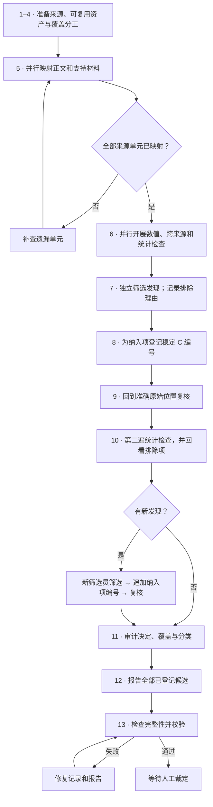

**Workflow 1.6.2 — 中文简明说明**

检查完整论文资料包，为每个已登记候选保留可追溯的原始证据，并将报告交给后续人工裁定。以下按原文规定的 13 个步骤组织。

| 步骤 | 关键操作 |
| --- | --- |
| 1. 运行预检 | 确认模型路由和工具，清点来源并记录哈希，初始化运行记录和角色执行记录。 |
| 2. 可复用资产 | 资产整理员检查已有文本、OCR、表格和图像，记录覆盖情况，并按内容标记 `REPORT` 或 `PLAN`。 |
| 3. 覆盖缺口 | 为每个未覆盖单元安排重新读取；可复用单元加需重新读取单元必须等于全部单元。 |
| 4. 分工登记 | 在覆盖清单中记录互不重叠的范围、阶段和输出路径。 |
| 5. 证据映射 | 正文和支持材料映射员并行建立数值关系（`N`）与统计关系（`S`），保留准确来源位置。 |
| 6. 专门检查 | 数值、跨来源和统计第一遍检查员应用纳入规则，输出 `F` 发现及带理由代码的排除记录。 |
| 7. 独立筛选 | 新筛选员重读每个发现的原始位置，独立应用阈值，并合并重复问题。 |
| 8. 候选登记 | 协调者仅为纳入项分配稳定 `C` 编号，保留来源、领域和文件关系。 |
| 9. 证据复核 | 新复核员核对准确原文、计算和分类，记录转录修正、缺失输入与证据状态。 |
| 10. 统计第二遍 | 另一名新审查者重查全部 `S` 关系和检查员排除项；新发现须经新筛选员筛选，再追加编号并复核。 |
| 11. 质量审计 | 审计纳入、排除、覆盖与分类；救回的遗漏项须登记并复核，已有编号不得删除。 |
| 12. 报告生成 | 报告全部已登记候选、证据及限制；完整检查后也可以形成零候选报告。 |
| 13. 最终校验 | 完成记录、核对哈希、生成工作流报告并清理临时工具；修复校验失败，直至 `PASS`。 |

**决定纳入与复核结果的关键规则**

- **纳入条件：已复现，且满足 A 或 B。** A 为规范列出的始终登记类别；B 要求同时属于定量范围、无法由附近上下文立即消解，且可能改变某个具体结果的解释或提取值。
- **先处理舍入。** 传播半个末位单位的显示精度区间；剩余间隔须超过参考值绝对值的 5%。参考值为零时，任何正间隔均通过。区间与检验或 P 值冲突不适用这一舍入筛选。
- **复用提取结果，不复用旧判断。** 旧候选列表不能限定发现范围；全部来源单元都须映射，无适用内容的单元也须明确记录。
- **保留稳定编号。** 即使证据状态为 `not_reproduced`，候选仍保留在账本和报告中；新发现只能追加编号。
- **区分检查与裁定。** 第二遍能看到前序输出，并非盲法复现；审计的 `CONFIRMED` 和程序的 `PASS` 均不等于科学判断正确。

工作流结束后，由人工在最终工作簿中决定保留、排除或讨论，并判断确定性与实质性。

依据所提供的[工作流规定步骤](supporting/source_references/workflow1.6.2/AGENTS.md#required-workflow)、[审查契约](supporting/source_references/workflow1.6.2/workflow_1_6_2/review_contract.md)及[质量控制范围](supporting/source_references/workflow1.6.2/QUALITY_CONTROL_SCOPE.md)。[English version](workflow_1_6_2_EN.md)。
