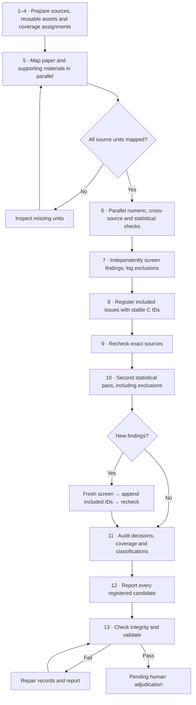

**Workflow 1.6.2 — concise English guide**

Review a complete paper package, retain a source-linked record of every registered candidate, and hand the report to human adjudication. The sequence below follows the original document’s 13 required steps.

| Step | Key action |
| --- | --- |
| 1. Preflight | Verify model routing and tools; inventory and hash sources; initialize run and agent records. |
| 2. Reusable assets | The curator checks existing text, OCR, tables and images, records coverage, and tags sources as `REPORT` or `PLAN`. |
| 3. Coverage gaps | Assign every uncovered source unit to fresh inspection; reusable plus fresh-required units must equal the total. |
| 4. Assignments | Record disjoint scopes, stages and output paths in the coverage manifest. |
| 5. Mapping | Two mappers cover the main paper and supporting materials in parallel, recording numeric (`N`) and statistical (`S`) relationships with exact locations. |
| 6. Checking | Numeric, cross-source and statistical pass-1 reviewers apply the inclusion rules, producing `F` findings and reason-coded exclusions. |
| 7. Screening | A fresh screener rereads every finding’s sources, applies the threshold independently, and consolidates duplicate issues. |
| 8. Registration | The coordinator assigns stable `C` IDs only to included issues, preserving provenance, domains and document relationships. |
| 9. Evidence recheck | A fresh rechecker verifies exact sources, calculations and classifications, recording corrections, missing inputs and evidence states. |
| 10. Statistical pass 2 | A different fresh reviewer revisits every `S` relationship and checker exclusion; new findings require a fresh screen, appended IDs and recheck. |
| 11. Audit | Audit inclusion, exclusions, coverage and classifications; register and recheck rescued findings without deleting existing IDs. |
| 12. Reporting | Include every registered candidate, its evidence and limitations; complete coverage may also yield a zero-candidate report. |
| 13. Validation | Finalize records, verify hashes, render the workflow report, remove temporary tooling and repair validation failures until `PASS`. |

**Rules that control the decisions**

- **Include when reproduced AND (A OR B).** A covers the specified always-register categories; B requires quantitative relevance, no immediate contextual resolution, and potential to change a named result’s interpretation or extraction.
- **Account for rounding first.** Propagate half-unit display intervals; the remaining gap must exceed 5% of the absolute reference value. For a zero reference, any positive gap qualifies. CI–test/P conflicts are exempt from this rounding screen.
- **Reuse extraction, not old judgments.** Old candidate lists do not define discovery; every source unit must be mapped, including explicit records for units with no applicable content.
- **Preserve registered IDs.** Even `not_reproduced` candidates remain in the ledger and report. New findings are appended without renumbering.
- **Separate checks from judgment.** Pass 2 sees earlier outputs; it is not blinded replication. Audit `CONFIRMED` and validator `PASS` do not establish scientific correctness.

Human review follows the workflow: decide retain/exclude/discuss, certainty and substantiveness in the final workbook.

Based on the supplied [required workflow](supporting/source_references/workflow1.6.2/AGENTS.md#required-workflow), [review contract](supporting/source_references/workflow1.6.2/workflow_1_6_2/review_contract.md) and [quality-control scope](supporting/source_references/workflow1.6.2/QUALITY_CONTROL_SCOPE.md). [中文版](workflow_1_6_2_CN.md).
