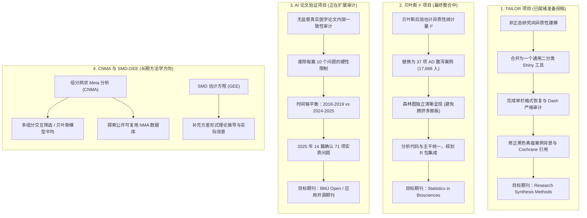

# 导师指导要点（Mentor Tips）与学生论文写作错误（Student Errors）全景深度总结

> **数据来源**：基于本地四个子目录（`June-12`、`June-30`、`July-24`、`August-14`）中的全部会议转录稿（Transcripts）、人工会议笔记（Notes）、LaTeX 总结报告（Meeting Summaries）、修订计划及审计文件深度交叉整理与校对。

---

## 目录

1. [执行摘要与核心矩阵（Executive Summary）](#一执行摘要与核心矩阵)
2. [四次导师会议全纪录与演进脉络（Chronological Analysis）](#二次导师会议全纪录与演进脉络)
   - [2026-06-12 会议：项目启动、模型构建与初步写作规范](#1-2026-06-12-会议项目启动模型构建与初步写作规范)
   - [2026-06-30 会议：逻辑重构、分布原理解释与软件文献差距](#2-2026-06-30-会议逻辑重构分布原理解释与软件文献差距)
   - [2026-07-24 会议：排版格式、标点符号规范与案例深度溯源](#3-2026-07-24-会议排版格式标点符号规范与案例深度溯源)
   - [2026-08-14 会议：论文终审、案例精简、Prompt 缺陷纠正与投稿策略](#4-2026-08-14-会议论文终审案例精简-prompt-缺陷纠正与投稿策略)
3. [学生在论文写作与研究过程中犯下的具体错误（Student Errors Catalog）](#三学生在论文写作与研究过程中犯下的具体错误)
   - [3.1 统计学与方法学概念错误（Methodological & Statistical Errors）](#31-统计学与方法学概念错误)
   - [3.2 案例数据、文献引用与效应量比较错误（Data, Citation & Comparison Errors）](#32-案例数据文献引用与效应量比较错误)
   - [3.3 标点符号、LaTeX 排版与语言规范错误（Typography, LaTeX & Language Errors）](#33-标点符号latex-排版与语言规范错误)
   - [3.4 研究设计与 AI 提示词工程缺陷（Study Design & Prompt Engineering Flaws）](#34-研究设计与-ai-提示词工程缺陷)
4. [导师的指导原则与学术建议（Mentor Tips & Best Practices）](#四导师的指导原则与学术建议)
   - [4.1 学术论文写作结构与逻辑框架技巧（Manuscript Structure & Framing）](#41-学术论文写作结构与逻辑框架技巧)
   - [4.2 统计建模与分布选择的实际背景解释（Practical Statistical Justifications）](#42-统计建模与分布选择的实际背景解释)
   - [4.3 AI 时代的科研方法、验证流程与学术伦理（AI-Assisted Research Workflow）](#43-ai-时代的科研方法验证流程与学术伦理)
   - [4.4 科研项目管理与学术职业发展（Research Management & Career Development）](#44-科研项目管理与学术职业发展)
5. [四大核心研究项目进展归纳（Project-by-Project Summary）](#五四大核心研究项目进展归纳)
6. [学术论文写作避坑清单（Manuscript Self-Checklist）](#六学术论文写作避坑清单)

---

## 一、执行摘要与核心矩阵

在为期两个多月（2026年6月至8月）的四次指导会议中，导师（Dr. Lifeng Lin）对学生（Bulun Te）的多个研究课题进行了全方位的学术指导，涵盖：
1. **TAILOR 贝叶斯非正态随机效应 Meta 分析与 Shiny 应用论文**（投稿目标：*Research Synthesis Methods*）；
2. **贝叶斯 $I^2$ 异质性统计量估计论文与 R 案例研究**（投稿目标：*Statistics in Biosciences*）；
3. **AI 辅助医学已发表论文内部一致性系统审计项目**（Applied AI Paper，目标：*BMJ Open* 等开源应用期刊）；
4. **标准化均数差（SMD）的 GEE 估计方程方法**（方法学拓展）；
5. **网状 Meta 分析中的组分模型（Component Network Meta-Analysis, CNMA）**（博士论文长期方向）。

下表总结了学生在写作中暴露的主要问题与导师给出的核心指导意见：

| 维度 | 学生所犯主要错误（Student Errors） | 导师指导要点（Mentor Tips） |
| :--- | :--- | :--- |
| **理论与概念** | 1. 混淆参数在变换后的中位数/均值解释（在非对称分布下将 $\exp(\mu)$ 误作各研究间中位数比值）。 2. 混淆 MCMC 后验汇总统计量（Posterior summary）与模型先验/异质性分布参数解释（误引 NICE TSU 10/16）。 3. 引入缺乏实际解释性的非对称混合正态模型。 | 1. 明确参数在 log 尺度与原始尺度变换时的单调不变性（中位数具备单调不变性，均值不具备）。 2. 采用均值/中位数归零且方差归一化的标准化分布（如 Gamma-difference 分布）。 3. 若模型只能保证均值归零，必须在 Limitation 中明确说明解释力局限。 |
| **写作与框架** | 1. 将通用贝叶斯方法论文写成单一黑色素瘤数据集的应用报告。 2. 在 Introduction 塞入无关的 SMD-OR 互相转换公式。 3. 频繁重复方法推导公式，使方法节与 Shiny 节内容高度重合。 4. 未全面检索现有 R 包（如 `bayesmeta`, `meta`）即断言“尚无此类软件”。 | 1. 论文应定位为非正态随机效应框架的 Review + Robustness 分析 + Shiny 工具，数据集仅作 Working example。 2. 严格遵循经典结构：背景与事实 $\rightarrow$ 明确痛点与空白 $\rightarrow$ 提出方法 $\rightarrow$ 案例验证 $\rightarrow$ 讨论与局限。 3. 正确引用公式标签 `\eqref{...}`，避免冗余推导；声明软件空白需严谨（加“To the best of our knowledge”）。 |
| **数据与案例** | 1. 案例部分缺失临床背景、干预/对照组定义与结局指标说明。 2. 参考文献误引无关的四篇候选综述（如热射病、流感疫苗），未准确对应当前黑色素瘤数据。 3. 错误计算原综述结果（误记为不显著的 $RR=1.23$，实际为显著的 $RR=1.36$）。 4. 将 TAILOR 的 OR 估计值与原综述的 RR 估计值进行直接数值大小比较。 | 1. 案例必须详细介绍疾病背景、人群特征、干预措施、主要结局及原综述来源与 Citation。 2. 严禁引用未在正文中使用的数据源综述。 3. OR 与 RR 尺度不同，只能定性比较效应方向（Direction）和不确定性（Uncertainty），不可直接数值等价。 |
| **排版与规范** | 1. 混淆短横线（Hyphen `-`）、连接号（En dash `--`）、破折号（Em dash `---`）与数学减号（`$-$`）。 2. 人名组合（`Gelman-Rubin`, `Hartung-Knapp-Sidik-Jonkman`）与数值范围错误使用 Hyphen。 3. 滥用 Em dash 导致文章充满 AI 生成痕迹。 4. 投递 RSM 时错误使用双栏（Two-column）排版；英美式拼写混用（`modelling` vs `modeling`）。 | 1. 联合冠名人名、数值范围必须使用 LaTeX En dash `--`。 2. 谨慎使用 Em dash，长停顿优先改用逗号或自然从句，消除 AI 腔调。 3. 严格遵循期刊最新 Author Instructions（RSM 转由剑桥大学出版社出版后要求单栏排版）。 4. 统一使用美式英语拼写。 |
| **AI 研究方法** | 1. 审计 Prompt 机械限制“每篇文章找出10个错误”，导致多错论文漏报、干净论文强行找茬（产生无意义的鸡毛蒜皮项）。 2. 纵向比较时间窗口不对称（1年 pre-COVID vs 2年 post-COVID）。 3. 将未完全确认的 AI flag 直接当作确凿错误（Error）。 | 1. Prompt 应基于清晰的错误类型定义，不设数量上限，要求检出所有可支持的事实性问题。 2. 纵向对比时间段必须对称（如 2018–2019 vs 2024–2025），且避免做不严谨的因果推断（COVID 与 AI 普及均为混合因素）。 3. 必须坚持 Human-in-the-loop，区分 Candidate flags、确凿错误与汇报规范差异。 |

---

## 二、四次导师会议全纪录与演进脉络

### 1. 2026-06-12 会议：项目启动、模型构建与初步写作规范
- **会议背景**：讨论学生开发的两个 Shiny 应用（Grid 超参数网格 vs Flat Prior 分层先验模型）、SMD 的 GEE 估计方法，以及导师在真实审稿经验中萌发的 AI 论文一致性验证构想。
- **导师指导要点**：
  1. **Shiny 应用与论文定位**：不要将软件局限在单一的黑色素瘤（Melanoma）数据上，应整合两个独立应用为一个通用的二分类结局（Binary Outcome）贝叶斯 Meta 分析工具。黑色素瘤数据作为贯穿全文的 Working Example。
  2. **模型参数解释（Estimand）**：在对数几率比（Log Odds Ratio）尺度上，随机效应分布如果关于 0 对称，则 $\exp(\mu)$ 可自然解释为研究间的中位数 Odds Ratio（Median OR across studies）；但如果分布是不对称的（如 Gamma 分布），$\exp(\mu)$ 不再是中位数 OR，必须进行重中心化（Recentering）或在写作中做出明确限定与说明。
  3. **模型对比与先验设置**：注意到 REML 估计的异质性方差 $\tau^2=0$ 而贝叶斯模型保留了后验不确定性，导师指出这正是贝叶斯方法在异质性研究中的优势所在，应系统探究。
  4. **AI 验证项目发起**：导师分享了审稿时使用 Business AI 发现作者“点估计不在 CI 内”、“不同结局 CI 完全一致（复制粘贴漏改）”、“正文更新但附录未更新”的真实经历，建议开展一项针对 JAMA/BMJ 约 100 篇临床研究的无监督审计探索。
- **学生暴露的初始问题**：
  - 将软件与方法论文局限在黑色素瘤这单一特定数据集；
  - 对非对称分布下效应量 $\mu$ 与 $\exp(\mu)$ 的统计解释缺乏严谨性；
  - 混淆了固定效应（Fixed Effects / Common Effect）与随机效应在方法学论文中的权重。

---

### 2. 2026-06-30 会议：逻辑重构、分布原理解释与软件文献差距
- **会议背景**：讨论 TAILOR 论文初稿的修改、流程图优化、AI 验证项目的 Protocol 制定，以及组分网状 Meta 分析（CNMA）的文献方向。
- **导师指导要点**：
  1. **引言逻辑重构（Introduction Framing）**：引言第一段必须直接从“Meta 分析中研究间异质性违背正态假设（Non-normal between-study heterogeneity）”这一核心痛点切入，随后过渡到二分类结局的贝叶斯分层模型，最后引出软件工具。
  2. **为应用研究者赋予分布选择的实际意义**：
     - **重尾分布（Heavy-tailed, 如 Student $t$）**：对应离群研究（Outliers）、极端效应值、纳入人群极度异质（Diverse populations）、研究质量存疑或证据污染。
     - **偏态分布（Skewed, 如 Gamma）**：对应发表偏倚（Publication bias）、传播偏倚（Dissemination bias）或选择性结局报告偏倚（Selective outcome reporting），本质是非随机缺失（MNAR）。
     - **混合分布（Mixture）**：对应潜在亚组（Latent subgroups）或效应修饰（Effect modification），如未识别的人群差异。
  3. **软件空白的客观陈述**：全面检索现有的 Meta 分析 R 包（`metafor`, `meta`, `bayesmeta`）和 Shiny 界面。声明“尚无此类软件”必须严谨，使用“To the best of our knowledge”并给出文献/软件佐证。
  4. **方法学内容精简与术语统一**：大幅删减通用的 Frequentist 基础公式，因为软件核心是贝叶斯分层模型；在 LaTeX 中统一使用 Common Effect（CE）替代 Fixed Effect（FE）。
  5. **纠正学生的错误引用与非对称混合分布处理**：
     - 学生试图引用 NICE TSU 10 和 16 来解决分布中心化问题，导师明确指出该文献讨论的是 MCMC 后验汇总统计量（Posterior summary），而非模型中研究间分布参数的解释，两者不相干；
     - 对于无法将中位数约束为 0 的 Shifted Mixture 模型，直接解释为 Mean log OR，并在 Limitation 中明确说明失去了原始 OR 尺度的中位数解释。
  6. **图表与语言规范**：流程图标准化图形（避免单个椭圆出现一次）、统一决策菱形、统一箭头长短、精简配色；全篇采用美式英语（如 `modeling` 而非 `modelling`）。
- **学生暴露的写作问题**：
  - 引言中加入了无关的文献引用（如 SMD 与 OR 互相转换的公式）；
  - 误引 NICE TSU 技术文档；
  - 流程图形状混乱、颜色繁杂、箭头长短不一；
  - 拼写存在英式与美式混用。

---

### 3. 2026-07-24 会议：排版格式、标点符号规范与案例深度溯源
- **会议背景**：TAILOR 论文投递前评审、排版与数据溯源审查；AI 验证项目 pilot 进展（20篇 JAMA 产生 111 个 candidate flags）。
- **导师指导要点**：
  1. **恢复期刊官方单栏排版**：RSM 转由 Cambridge University Press 出版后要求单栏格式，学生擅自修改的双栏排版必须全部撤销，调整超宽表格以适配单栏。
  2. **自由度先验 $U(2.01, 32)$ 的严谨说明**：下界 $2.01>2$ 是为了保证理论方差存在且有限；上界 $32$ 是覆盖近似正态尾部的实用默认值，必须在正文中说明此先验是“用户可调节的默认值（User-modifiable default）”。
  3. **消除方法节与 Shiny 节的公式与描述冗余**：为方法节的核心公式添加 `\label{...}`，在 Shiny 节直接使用 `\eqref{...}` 进行交叉引用，严禁全文重复书写完全相同的公式和参数推导。
  4. **案例研究深度补充与溯源纠错**：
     - 案例不可简单草率带过，必须补充完整的临床背景（转移性皮肤黑色素瘤）、干预措施、肿瘤客观缓解率（Tumour response）二分类结局定义、Cochrane 原始综述 Citation；
     - 明确指出 Cochrane 原始综述计算的是风险比（Risk Ratio, RR），而 TAILOR 估计的是几率比（Odds Ratio, OR），两者数值尺度不同，只能定性比较效应方向和置信区间宽度，不可直接进行数值大小等价。
  5. **严格的 Dash 与标点符号审计**：系统区分 Hyphen (`-`)、En dash (`--`)、Em dash (`---`) 和数学减号 (`$-$`)。联合人名（如 `Gelman--Rubin`、`Hartung--Knapp--Sidik--Jonkman`）和数值范围必须使用 LaTeX En dash；大幅减少 Em dash 避免 AI 写作腔调。
  6. **AI 验证项目的抽样与潜在偏倚处理**：20 篇 JAMA 筛出 111 个 flags，导师指出必须注意 COVID-19 紧急公卫事件期间的发表文章可能由于 rushed publication 而天然存在更多错误，这构成混杂因素（Confounder），必须在讨论或抽样设计中予以说明。
- **学生暴露的写作与数据问题**：
  - 擅自将期刊模板改为双栏；
  - 案例描述极度简略（仅一句话），未提供临床背景与数据引用；
  - 初版修订计划中引用了完全无关的热射病、流感疫苗综述，并算错了原综述的数值结果；
  - 全文大量混淆短横线与连接号。

---

### 4. 2026-08-14 会议：论文终审、案例精简、Prompt 缺陷纠正与投稿策略
- **会议背景**：贝叶斯 $I^2$ 论文案例替换与绘图；TAILOR 论文最终核对与投稿准备；AI 验证项目 2025 年 14 篇数据审计（71 个确凿问题）与 Prompt 缺陷修正。
- **导师指导要点**：
  1. **贝叶斯 $I^2$ 论文案例整合**：学生新提取的阿尔茨海默病/帕金森认知障碍患者胆碱酯酶抑制剂腹泻不良反应案例（37项试验，17,688人）质量极佳，具有中等异质性（$I^2 \approx 50.7\%$），应直接**替换**掉原有的第二个案例，保持全文三个经典案例结构，避免扩充为四个使文章冗长。
  2. **绘图与代码规范**：森林图（Forest plot）应单独作为清晰独立图表呈现，不要强行拼凑成难以阅读的多面板图（Multi-panel plot）；分析与制图脚本必须与导师的共享核心代码库保持一致，种子数（Random seeds）必须严格记录并可复现。
  3. **彻底纠正 AI 审计 Prompt 的核心缺陷**：
     > **关键纠偏**：学生在 Prompt 中设定了“每篇文章挑出10个问题”，导师指出这是严重的 Prompt Engineering 缺陷——它会人为压制高错误率论文中的其他严重问题，同时迫使模型在高质量、无错误的论文中强行搜刮鸡毛蒜皮的无意义格式琐事。必须立即移除 10 个问题的硬性限制，改为基于明确定义的错误分类检索所有站得住脚的问题。
  4. **纵向比较的时间窗口平衡**：将对比时间段设定为对称的两年对两年：**2018–2019（Pre-COVID / Pre-Generative-AI） vs 2024–2025（Post-COVID / AI Era）**。在文章中必须客观呈现数据，不可做出未经证明的因果断言（无法直接将错误率变化完全归因于 AI 或 COVID）。
  5. **主文与附录呈现策略**：主文聚焦问题类型的统计分布，并挑出若干具有明确科学/临床解释后果的典型错误（如混淆发生率 Rate 与计数 Count 导致 100 人年发生率被荒谬相加；混淆婴儿与母亲分析单位；错配调整与未调整结果）；极其详尽的逐篇模型推理与位置记录放入 Supplementary Material。
- **学生暴露的写作与设计问题**：
  - 在 Prompt 中设置机械的数量限制（Top 10 issues），破坏了审计研究的方法学严谨性；
  - 初始纵向抽样时间段不对称（1年 vs 2年）；
  - 试图在贝叶斯 $I^2$ 论文中堆砌四个案例并制作拥挤的多面板图。

---

## 三、学生在论文写作与研究过程中犯下的具体错误

### 3.1 统计学与方法学概念错误

#### 1. 混淆非正态分布下参数变换后的中位数与均值解释（Estimand Misspecification）
- **错误细节**：在随机效应 Meta 分析中，常规正态分布假定下，由于正态分布关于 0 对称，Log 尺度上的均值 $\mu$ 与中位数重合，因此指数变换后 $\exp(\mu)$ 自然等于研究间真实几率比的中位数（Median OR across studies）。然而，当学生引入非对称分布（如偏态 Gamma 分布或混合正态模型）时，在论文中依然直接套用 $\exp(\mu)$ 作为“Median OR”。
- **导师纠偏**：指数函数是单调变换，单调变换只保持中位数（Median）不变，不保持均值（Mean）不变。在非对称分布下，$\exp(E[\mu]) \neq E[\exp(\mu)]$，$\exp(\mu)$ 变成了没有直接临床实际意义的“对数几率比均值的指数”。如果无法构造中位数归零的分布，就必须在正文中明确将其称为“Mean of log odds ratio”，并在 Limitation 中承认失去了中位数解释力。

#### 2. 混淆 MCMC 后验汇总统计量与模型先验参数分布（Irrelevant Citation of NICE TSU）
- **错误细节**：学生试图引用 NICE Decision Support Unit Technical Support Document (NICE TSU) 第 10 篇和第 16 篇来作为自己中心化参数的依据。
- **导师纠偏**：导师指出 NICE TSU 10 和 16 讨论的是贝叶斯 MCMC 计算完成后，对后验样本（Posterior samples）应该报告 Mean 还是 Median 的经验建议，这属于后验估计值的汇总方式，而当前论文讨论的是**研究间先验随机效应真实分布（Between-study distribution）的中心化与参数定义**。引证对象完全风马牛不相及。

#### 3. 引入缺乏实际解释性的 Shifted Normal 混合分布
- **错误细节**：为了模拟双峰/混合情况，学生构造了一个均值不为 0 但加权均值为 0 的两组分正态混合模型，导致模型无法保证中位数归零，且参数在临床上极难解释。
- **导师纠偏**：要求删除 Shifted Normal 模型，改为构造对称的标准化 Gamma-difference 分布（均值与中位数均为 0，方差为 1），使重尾性质与可解释性得以兼顾。

#### 4. 固定效应（FE）在随机效应方法学论文中比重失调
- **错误细节**：在方法学初稿中花费大量篇幅介绍基础的 Frequentist 估计方法和固定效应公式，而该论文的核心贡献在于非正态随机效应分层模型。
- **导师纠偏**：大幅删减 Frequentist 公式推导，这些已有成熟 R 包支持，无需占用正文版面；在符号上将 Fixed Effect (FE) 统一更正为 Common Effect (CE)。

---

### 3.2 案例数据、文献引用与效应量比较错误

#### 1. 案例研究严重缺乏临床背景与数据引用（Incomplete Application Reporting）
- **错误细节**：在初稿的 Results / Case Study 章节中，学生仅用一两句话草率带过数据集，没有介绍疾病类型、干预措施与对照组定义、纳入研究数量、总样本量、二分类事件定义，且完全没有提供原始 Cochrane 综述的文献引用（Citation）。
- **导师纠偏**：明确指出使用他人整理的公开数据若不提供 Citation 属于学术不端隐患（Misconduct risk）。要求必须扩充为完整的背景段落，详细阐明转移性皮肤黑色素瘤的化疗背景及肿瘤缓解率定义。

#### 2. 候选数据源综述张冠李戴（Candidate Literature Mismatch）
- **错误细节**：在 7 月 24 日会议后的第一版修改计划（v1）中，学生列出了四篇候选文献，其中包括热射病降温技术（Heatstroke cooling）、环境高温暴露与心血管事件、流感疫苗心血管死亡综述，试图将其作为当前黑色素瘤数据的备选来源。
- **导师纠偏与审计确认**：经过 v2 审计，确认当前数据 100% 来自 Pasquali et al. (2018) Cochrane 综述《Systemic treatments for metastatic cutaneous melanoma》，其他三篇文献与当前 15 项化疗对比试验毫无关联，严禁强行挂靠未使用的参考文献。

#### 3. 原始综述合并效应量数据记录与计算错误（Data Calculation Error in Action Plan）
- **错误细节**：在 action plan v1 中，学生误将第一个黑色素瘤案例的 Cochrane 原始合并结果写为 `RR 1.23 (95% CI 0.60–2.50), I²=72%`，并据此得出“原综述不显著而 TAILOR 显著”的错误结论。
- **导师纠偏与审计纠正**：经严格复算，原综述对应 15 项研究的正确汇总结果为 `RR 1.36 (95% CI 1.12–1.66), I²=17%`，原综述本身即显示化疗联合干扰素具有统计学显著的肿瘤缓解获益，两者在定性结论上完全一致。

#### 4. 混淆几率比（OR）与风险比（RR）的数值可比性（Invalid Effect Measure Equivalence）
- **错误细节**：学生试图将 TAILOR 计算出的贝叶斯 Odds Ratio 数值与 Cochrane 原文报告的 Risk Ratio 数值进行直接对比。
- **导师纠偏**：OR 与 RR 是不同的效应度量指标，只有在罕见事件下两者才近似相等；在肿瘤缓解这种常见事件中，OR 的数值通常远离 1（偏离度大于 RR）。必须在正文中明确区分，两者只能在**效应方向（Direction）和不确定性区间（Uncertainty）**上做定性比较，严禁进行数值等价。

#### 5. 引言中堆砌无关的方法学文献（Tangential Literature Citations）
- **错误细节**：在 Introduction 讨论正态性假设时，学生因看到其他文献引用频繁，便将连续变量标准化均数差（SMD）与二分类几率比（OR）之间的数学转换公式及文献引用写入引言。
- **导师纠偏**：指出 TAILOR 软件自始至终只处理二分类数据的真实事件数与样本量（$2 \times 2$ 表），从未涉及 SMD 转换，引入无关公式只会严重干扰读者的阅读焦点，必须彻底删除。

---

### 3.3 标点符号、LaTeX 排版与语言规范错误

#### 1. 混淆 Hyphen、En dash、Em dash 与 Minus sign（Punctuation Errors）
- **错误细节**：
  - **人名连接错误**：在双人名或多人联合冠名的学术术语中使用单个短横线，写成 `Gelman-Rubin`、`Hartung-Knapp-Sidik-Jonkman`；
  - **数值范围错误**：在置信区间和页码范围中使用短横线，写成 `1.12-1.66`、`pages 457-472`；
  - **Em dash 滥用**：正文中出现大量包含 `---` 的长难句，带有强烈的未经编辑的 AI 提示词生成特征；
  - **数学减号错误**：在文本环境中使用文本 Hyphen 代替数学模式减号 `$-$`。
- **导师纠偏**：
  - 单个 Hyphen (`-`) 仅用于复合修饰词（Compound modifiers, 如 `two-stage analysis`, `heavy-tailed distribution`）；
  - 两个 Hyphen 构成的 En dash (`--`) 专用于连接同等地位的人名（`Gelman--Rubin`）、数值/页码范围（`1.12--1.66`）以及对应关系；
  - 三个 Hyphen 构成的 Em dash (`---`) 必须极其克制地使用，强停顿建议改写为自然从句或逗号；
  - 数学公式中的减法必须置于数学模式内。

#### 2. 期刊投稿模板与单双栏混淆（Journal Template Violation）
- **错误细节**：投递 *Research Synthesis Methods* (RSM) 时，学生擅自采用了类似 arXiv 的两栏（Two-column, `\documentclass[twocolumn]{...}`）排版，并使用了自定义的浮动体和跨栏表格 `table*`。
- **导师纠偏**：指出 RSM 目前已转由剑桥大学出版社出版，官方要求必须使用标准的**单栏（Single-column）格式**，要求学生将所有双栏环境全部剥离，重新调整宽表格布局以适配单栏页面。

#### 3. 公式与文字在章节间不必要的完全重复（Unnecessary Equation Repetition）
- **错误细节**：在第 2 节方法推导中写出的标准化公式、分层模型方程，在第 3 节 Shiny 软件界面介绍中原封不动地全盘重写了一遍。
- **导师纠偏**：要求为方法节的核心公式赋予 Label（如 `\label{eq:std_gamma}`），在 Shiny 软件节通过 `\eqref{...}` 进行交叉引用，软件节应保持纯粹的应用导向，严禁全文重复书写冗长的数学推导。

#### 4. 英美式英语拼写混淆（Spelling Inconsistencies）
- **错误细节**：正文与图表插图中混入英式拼写，如 `modelling`、`handling` 带有双 L。
- **导师纠偏**：要求全文统一使用标准美式英语（American English, 如 `modeling`）。

#### 5. 流程图（Flowchart）设计不规范
- **错误细节**：初始流程图中，椭圆形仅在开头出现了一次，后续形状各异；决策菱形使用不规范；箭头长短不一；配色杂乱（红、绿、黄无规律混用）。
- **导师纠偏**：统一起始与过程框形状，仅决策步骤使用菱形；统一箭头长度；去除刺眼的多余色彩或将颜色严格对应到软件的分析阶段模块；对关键操作文字进行局部加粗。

---

### 3.4 研究设计与 AI 提示词工程缺陷

#### 1. Prompt 人为设定“每篇抓10个错误”的严重缺陷（Artificial Output Cap）
- **错误细节**：在设计针对 2025 年 JAMA 论文的审计 Prompt 时，学生硬性规定“让大模型每篇文章挑出 10 个问题”。
- **导师纠偏**：指出这一限制带来了双重学术扭曲：
  1. 对于错误密集（Error-dense）的高问题论文，模型查到 10 个后便提前停止，遗漏了大量严重的实质性错误；
  2. 对于编写极其规范的高质量论文，模型在硬性指标驱动下，被迫抓取无伤大雅的排版鸡毛蒜皮（如脚注未重复正文已有定义）甚至发生幻觉。
  - **解决方案**：彻底废除固定数量限制，明确各类一致性指标的统计学定义，让模型检索所有具有事实支撑的问题。

#### 2. 纵向对比时间段设置不对称（Asymmetric Sampling Window）
- **错误细节**：在比较 AI 普及前后的论文错误率时，学生最初设定选取 2019 年（1年）对比 2024–2025 年（2年）。
- **导师纠偏**：指出时间窗口不对称会导致样本容量与发表基线不具可比性，要求调整为对称的两年对两年：**2018–2019 对比 2024–2025**，并在讨论中合理解释排除 2020–2022 年 COVID 高峰期的原因。

#### 3. 将 AI 候选标记与人工核实错误等同（Conflating Candidate Flags with Confirmed Errors）
- **错误细节**：在汇报 pilot 结果时，将大模型输出的“111 个 candidate flags”直接口头或在文字中表述为“发现了 111 个错误”。
- **导师纠偏**：必须在方法学上严格区分：AI 发现的是待审核的“候选标记（Candidate flags）”，必须经过专业统计人员的人工复核（Manual adjudication），排除合理的汇报惯例（Reporting conventions）与模型理解偏差后，才能确立为“已确认的不一致性（Confirmed inconsistencies）”。

---

## 四、导师的指导原则与学术建议

### 4.1 学术论文写作结构与逻辑框架技巧

1. **经典医学与统计应用论文的“四段论/五段论”架构**：
   - **Introduction（引言）**：仅陈述学术界已知的既定事实与背景（What is already known），摆出客观事实以引出研究动机，**严禁在引言中掺杂作者的推测、主观臆断或研究结论**；
   - **Methods（方法）**：清晰、严谨地描述所提模型的数学层次结构与计算步骤，提供足够的可复现细节；
   - **Results（结果）**：客观、透明地报告模拟实验与实证案例的数值发现，不夸大模型优势；
   - **Discussion（讨论）**：阐述研究结果的科学与临床意义（Implications），深入剖析本研究的局限性（Limitations），并说明这些局限性如何启发未来的研究方向（Future directions）；
   - **Conclusion（结论）**：位于讨论之后，高度概括全文核心贡献，篇幅极短（通常两三句话）。

2. **方法与软件结合型论文（Method-Software Paper）的写作平衡**：
   - 避免将软件论文降格为纯粹的代码说明书或单一数据集的分析报告；
   - 将软件定位为统计理论的实践载体，方法节提供严格的统计学推导，软件节聚焦于用户工作流、输入数据结构、诊断图表（DIC, WAIC, 收敛追踪）与输出解读。

3. **学术主张的严谨性与谦逊态度（Humble Scientific Claims）**：
   - 在宣称某种统计工具或软件具备“填补空白”的独创性时，必须经过详尽的文献与 CRAN/Bioconductor 检索，并在论文中使用“To the best of our knowledge”进行限定；
   - 模型优良性评估（如 DIC/WAIC 最优）应表述为“在当前数据集下的拟合优度更佳”，不可泛化为该模型在所有医学场景下绝对优越。

---

### 4.2 统计建模与分布选择的实际背景解释

1. **将抽象数学分布与真实世界数据生成机制（Data-Generating Mechanism）相映射**：
   - **Student $t$ 重尾分布**：向临床研究者解释为能够抵御“离群试验（Outlying studies）”和“异质人群偏离”，避免少数极端试验主导整个 Meta 分析结论；
   - **偏态分布（Gamma-difference）**：向读者解释为吸收由“发表偏倚/结局选择性报告”造成的非对称性；
   - **混合正态分布（Mixture Models）**：向读者解释为捕获由于未测量的协变量（如种族、年龄分层）导致的“潜在双峰/亚组效应”。

2. **单调变换下的参数不变性（Invariance under Monotone Transformation）**：
   - 牢记中位数在单调非线性变换（如 $\text{logit}$, $\exp$）下保持不变：$\text{Median}(f(X)) = f(\text{Median}(X))$；
   - 均值在非线性变换下不具备不变性：$E[f(X)] \neq f(E[X])$；
   - 在连接函数为非线性的广义线性混合模型（GLMM）中，始终优先使用以 0 为中位数的随机效应分布，以确保指数反变换后的参数能够清晰地解释为研究间的中位数效应（Median effect across studies）。

3. **实用性驱动先验参数设置（Practical Prior Defaults）**：
   - 避免向用户提供无法解释的黑箱参数；
   - 例如 $t$ 分布自由度先验 $\nu \sim U(2.01, 32)$：明确说明 $2.01$ 保证二阶矩有限（方差存在），$32$ 覆盖了与正态分布在肉眼上几乎无差别的临界尾部，且必须在软件中允许用户自定义。

---

### 4.3 AI 时代的科研方法、验证流程与学术伦理

1. **坚持“Human-in-the-Loop”的核心判断力**：
   - AI 可以极大加速搭框架、编写仿真代码和文本初稿的速度，但学术研究的根本在于批判性思维（Critical thinking）；
   - 研究者绝不能将 AI 的输出视为理所当然（Take for granted），必须对公式推导、数值结果、代码逻辑进行全覆盖的人工核查。

2. **无监督发现导向（Unsupervised Discovery Workflow）的研究范式**：
   - 在医学文献审计研究中，无需先验地人工构造带有假数据的训练集，直接利用现成大模型对真实发表的文献和附录进行无监督的一致性扫描；
   - 要求模型不仅报告问题，而且必须输出详尽的上下文依据、行号与逻辑解释，随后由两名及以上独立研究者进行人工仲裁（Manual adjudication）。

3. **追求可负担、普惠的模型验证（Cost-Effective & Accessible AI）**：
   - 证明轻量级、低成本或标准思考模型（Thinking models）能够稳定检出论文内部矛盾，其推广价值与实践意义远大于仅依靠极其昂贵的高阶专属模型；
   - 只有常规研究者用得起的工具，才具备转化为常规投稿前质量防护网（Quality safeguard）的现实可行性。

4. **科研数据安全与版权合规（Data Privacy & Compliance）**：
   - 处理未发表稿件、审稿材料或合作者专有数据时，必须使用明确承诺不将输入数据用于模型训练的企业/商业版（Business / Team tier）AI 工具，杜绝学术泄密风险；
   - 对已发表文献的非商业、学术性内部一致性审计，性质类似于系统评价中的数据提取，不构成商业侵权。

5. **AI 课题的敏捷推进策略（Rapid Execution for AI Projects）**：
   - 大语言模型迭代周期极短（以月为单位），AI 相关的应用型研究一旦完成分析，必须迅速成文并投递，防止审稿期间因所测模型版本落后而被审稿人质疑时效性。

---

### 4.4 科研项目管理与学术职业发展

1. **项目重叠推进策略（Overlapping Pipeline Strategy）**：
   - 博士生培养应保持科研产出的连续性：在 Finalize 第一篇论文写作与审稿的过程中，同步启动第二个方法学项目的调研与模拟，形成滚动推进的 Pipeline。

2. **区分核心方法学与辅助应用型论文**：
   - 博士期间的立身之本必须是坚实的统计理论与方法学创新（如 Bayesian Meta-Analysis, GEE-SMD, CNMA）；
   - AI 文献审计等应用型项目应作为“顺手推进的小课题（Lightweight applied paper）”，丰富研究多样性，但不可本末倒置挤占方法学攻关精力。

3. **代码与开源规范（Code & Package Best Practices）**：
   - 论文中的所有模拟实验与案例分析必须使用固定、显式记录的随机数种子（Random seeds）；
   - 核心统计方法应提前规划为标准 R 函数，规范命名与参数输出，便于后续整合进导师维护的开源 CRAN 包中。

4. **学术会议与学生论文竞赛（Conferences & Paper Competitions）**：
   - 积极关注 JSM（Joint Statistical Meetings）、各 ASA 分会（Section）的学生论文竞赛（Student Paper Awards）；
   - 提前 6–9 个月规划参赛论文，利用学术会议建立同行连接与展示学术成果。

---

## 五、四大核心研究项目进展归纳

---

## 六、学术论文写作避坑清单（Manuscript Self-Checklist）

在未来撰写任何学术手稿前，请严格对照本清单进行逐项自查：

- [ ] **1. Estimand 解释自查**：
  - [ ] 若对参数施加了非线性单调变换（如 $\exp(\cdot)$），该参数是否确实具备中位数不变性？
  - [ ] 是否存在把非对称分布下的 $\exp(E[\mu])$ 错误叫作中位数效应的情况？
- [ ] **2. 案例与数据引用自查**：
  - [ ] 是否详尽描述了临床背景、干预/对照组、样本量、事件发生数及结局指标？
  - [ ] 是否准确引用了数据的原始文献来源（而非中间无关综述）？
  - [ ] 是否避免了跨效应量尺度（如 OR vs RR）的直接数值大小等价？
- [ ] **3. 引言与文献自查**：
  - [ ] 引言第一段是否直击方法学核心痛点，而非空泛堆砌术语？
  - [ ] 是否彻底清除了与本文算法无关的公式与文献引用？
  - [ ] 声称“尚无软件”时是否检索了主流 R 包并加上了“To the best of our knowledge”？
- [ ] **4. 排版与标点符号自查**：
  - [ ] 人名联合冠名（`Gelman--Rubin`、`Hartung--Knapp--Sidik--Jonkman`）是否全部使用 LaTeX En dash `--`？
  - [ ] 数值、置信区间与页码范围（`1.12--1.66`）是否全部使用 En dash `--` 且两端无空格？
  - [ ] 是否排查并删除了文章中冗余、突兀的 Em dash `---`，改用流畅的逗号或自然从句？
  - [ ] 是否严格遵照期刊官方 Author Instructions（如单栏 vs 双栏排版）？
  - [ ] 是否统一采用美式英语拼写（如 `modeling`）？
- [ ] **5. 方法与软件结构自查**：
  - [ ] 软件介绍节是否通过 `\label` 和 `\eqref` 引用方法节公式，消除了数学推导的全文重复？
  - [ ] 流程图的几何形状、箭头长度与配色方案是否规范统一？
  - [ ] 所有的模拟代码和实证计算是否显式设定并记录了随机数种子（Random seeds）？
- [ ] **6. AI 辅助研究规范自查**：
  - [ ] 提示词设计是否避免了固定数量上限等扭曲数据分布的人为限制？
  - [ ] 所有的 AI 候选标记（Flags）是否均经过人工严格复核（Manual Adjudication）并留有可追溯记录？
  - [ ] 纵向时间抽样设计是否保持对称？是否对 COVID 等潜在混杂因素进行了合理解释？
